<!-- Generated by scripts/render_arluxis.py from arluxis.yml. Do not edit. -->
```{=html}
<nav class="galleries" id="galleries" aria-label="Galleries">
  <div class="galleries__inner">
    <a class="galleries__link" href="#nature" data-gallery="nature">Nature<span class="galleries__count">15</span></a>
    <a class="galleries__link" href="#sports" data-gallery="sports">Sports<span class="galleries__count">17</span></a>
    <a class="galleries__link" href="#street" data-gallery="street">Street<span class="galleries__count">15</span></a>
  </div>
</nav>

<div role="main">

  <!-- Nature -->
  <section class="chapter" id="nature" data-gallery="nature" aria-labelledby="nature-title">
    <header class="chapter__head">
      <h2 class="chapter__title" tabindex="-1" id="nature-title">Nature</h2>
    </header>
      <div class="plate" style="--r:1.5">
        <figure class="plate__figure" style="--r:1.5" data-full="images/arluxis/landscape_photography/DSCF9215.JPG" data-exif="X-T30 II|XF100-400mm F4.5-5.6|400 mm|f/9|1/2000 s|ISO 800|Classic Chrome">
          <button class="plate__open" type="button">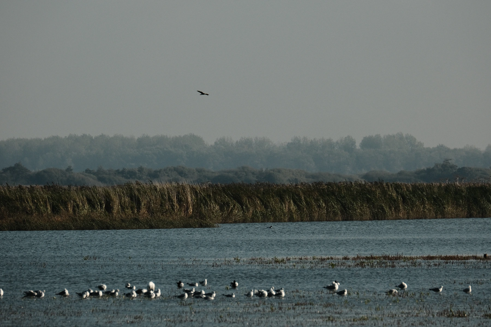</button>
          <figcaption class="plate__caption"><span class="plate__place">Friesland, October 2026</span><span class="plate__settings"><span>400 mm</span><span>f/9</span><span>1/2000 s</span><span>ISO 800</span></span></figcaption>
        </figure>
      </div>
      <div class="plate" style="--r:1.5">
        <figure class="plate__figure" style="--r:1.5" data-full="images/arluxis/landscape_photography/DSCF9061.JPG" data-exif="X-T30 II|XF100-400mm F4.5-5.6|335 mm|f/10|1/1250 s|ISO 320|Eterna">
          <button class="plate__open" type="button">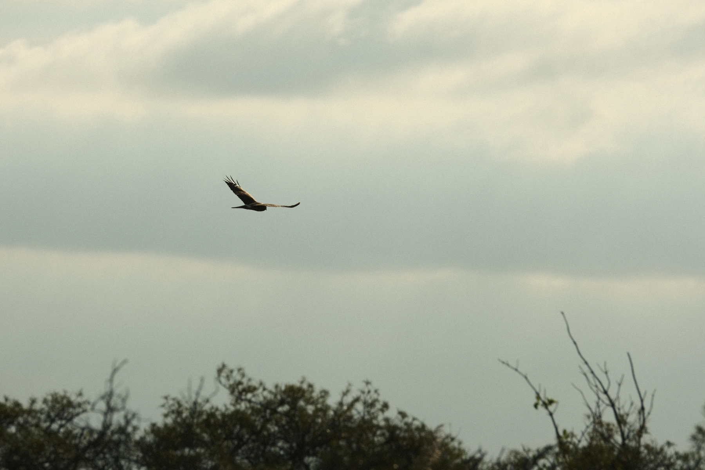</button>
          <figcaption class="plate__caption"><span class="plate__place">Friesland, October 2026</span><span class="plate__settings"><span>335 mm</span><span>f/10</span><span>1/1250 s</span><span>ISO 320</span></span></figcaption>
        </figure>
      </div>
      <div class="plate plate--spread" style="--r:1.3334">
        <div class="plate__pair">
          <figure class="plate__figure" style="--r:0.6667" data-full="images/arluxis/landscape_photography/DSCF8335.JPG" data-exif="X-T30 II|XF18-55mm F2.8-4|28 mm|f/5.6|1/1000 s|ISO 800|Classic Chrome">
            <button class="plate__open" type="button">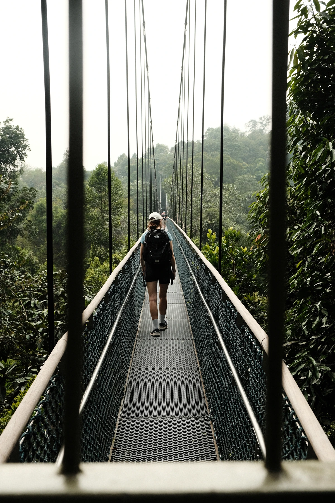</button>
            <figcaption class="plate__caption"><span class="plate__place">Singapore, October 2026</span><span class="plate__settings"><span>28 mm</span><span>f/5.6</span><span>1/1000 s</span><span>ISO 800</span></span></figcaption>
          </figure>
          <figure class="plate__figure" style="--r:0.6667" data-full="images/arluxis/landscape_photography/DSCF8302.JPG" data-exif="X-T30 II|XF18-55mm F2.8-4|55 mm|f/5.6|1/180 s|ISO 400">
            <button class="plate__open" type="button"></button>
            <figcaption class="plate__caption"><span class="plate__place">Singapore, October 2026</span><span class="plate__settings"><span>55 mm</span><span>f/5.6</span><span>1/180 s</span><span>ISO 400</span></span></figcaption>
          </figure>
        </div>
      </div>
      <div class="plate" style="--r:1.5">
        <figure class="plate__figure" style="--r:1.5" data-full="images/arluxis/landscape_photography/DSCF8167.JPG" data-exif="X-T30 II|XF18-55mm F2.8-4|36 mm|f/9|1/1000 s|ISO 400|Classic Chrome">
          <button class="plate__open" type="button">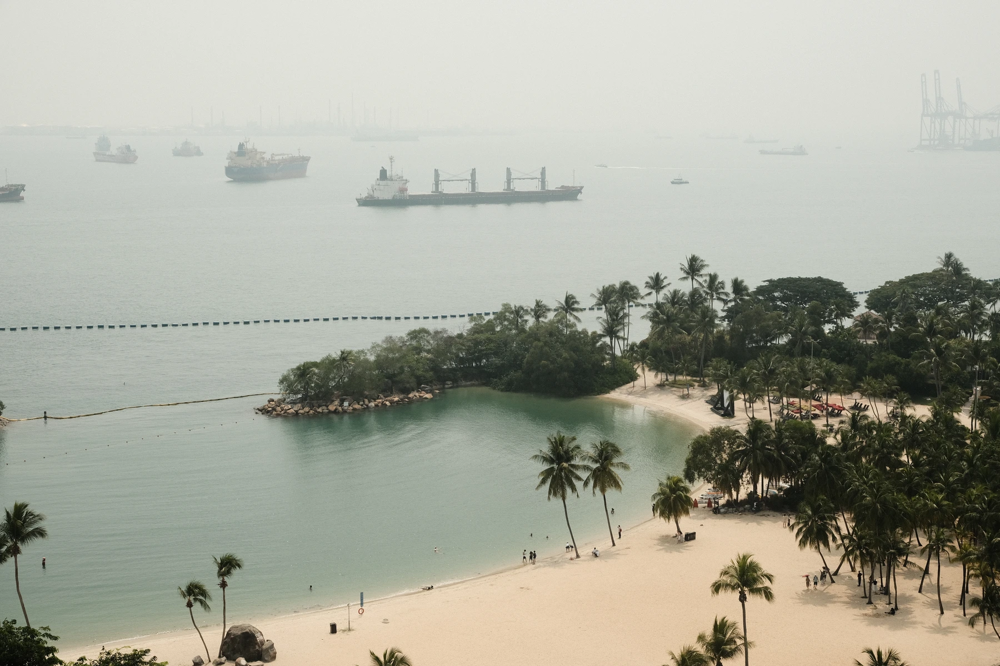</button>
          <figcaption class="plate__caption"><span class="plate__place">Singapore, October 2026</span><span class="plate__settings"><span>36 mm</span><span>f/9</span><span>1/1000 s</span><span>ISO 400</span></span></figcaption>
        </figure>
      </div>
      <div class="plate" style="--r:0.6667">
        <figure class="plate__figure" style="--r:0.6667" data-full="images/arluxis/landscape_photography/DSCF7423.JPG" data-exif="X-T30 II|XF18-55mm F2.8-4|34 mm|f/22|1/8 s|ISO 320|Eterna">
          <button class="plate__open" type="button"></button>
          <figcaption class="plate__caption"><span class="plate__place">Singapore, September 2026</span><span class="plate__settings"><span>34 mm</span><span>f/22</span><span>1/8 s</span><span>ISO 320</span></span></figcaption>
        </figure>
      </div>
      <div class="plate" style="--r:1.5">
        <figure class="plate__figure" style="--r:1.5" data-full="images/arluxis/landscape_photography/DSCF3136.JPG" data-exif="X-T30 II|XF27mm F2.8|f/8|1/4000 s|ISO 640|Classic Negative">
          <button class="plate__open" type="button">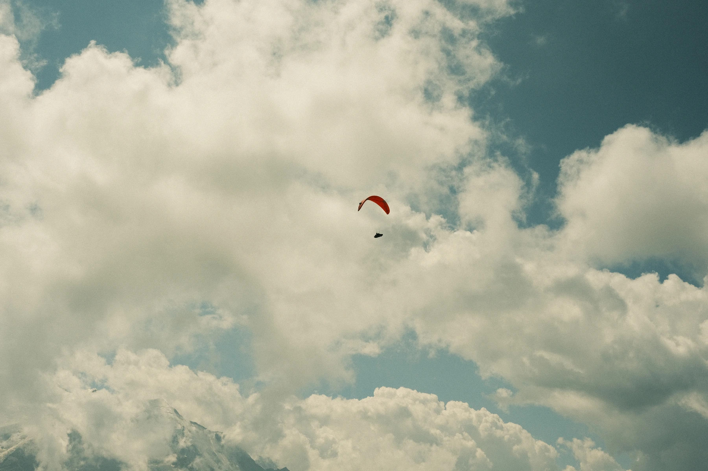</button>
          <figcaption class="plate__caption"><span class="plate__place">Chamonix, August 2026</span><span class="plate__settings"><span>27 mm</span><span>f/8</span><span>1/4000 s</span><span>ISO 640</span></span></figcaption>
        </figure>
      </div>
      <div class="plate" style="--r:1.5">
        <figure class="plate__figure" style="--r:1.5" data-full="images/arluxis/landscape_photography/DSCF3096.JPG" data-exif="X-T30 II|XF27mm F2.8|f/9|1/1000 s|ISO 400|Classic Chrome">
          <button class="plate__open" type="button">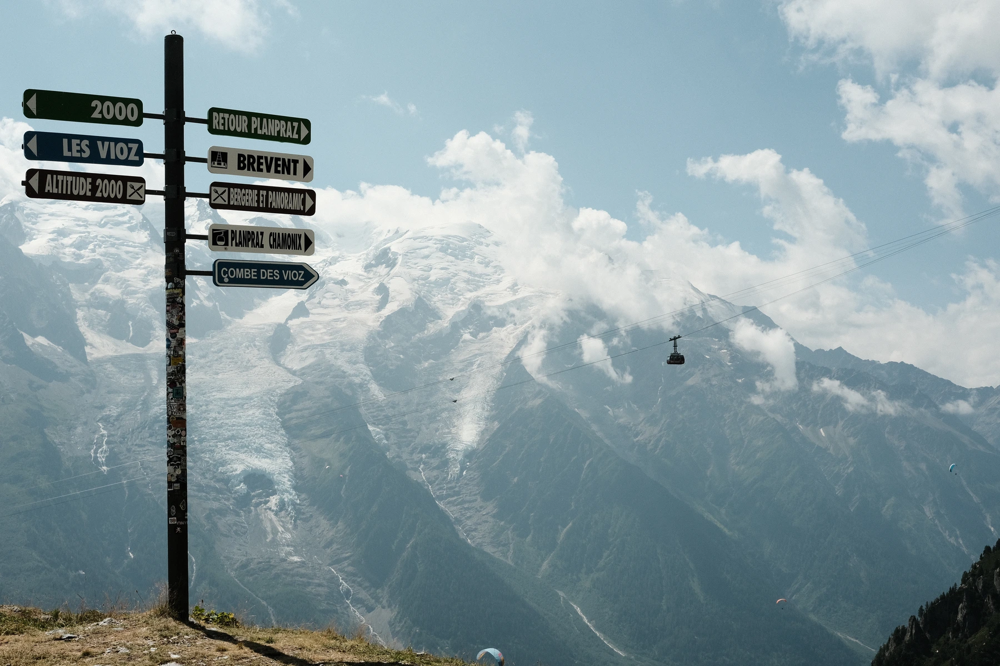</button>
          <figcaption class="plate__caption"><span class="plate__place">Chamonix, August 2026</span><span class="plate__settings"><span>27 mm</span><span>f/9</span><span>1/1000 s</span><span>ISO 400</span></span></figcaption>
        </figure>
      </div>
      <div class="plate" style="--r:0.6667">
        <figure class="plate__figure" style="--r:0.6667" data-full="images/arluxis/landscape_photography/DSCF8884.JPG" data-exif="X-T30 II|XF18-55mm F2.8-4|44 mm|f/5|1/800 s|ISO 320|Classic Chrome">
          <button class="plate__open" type="button">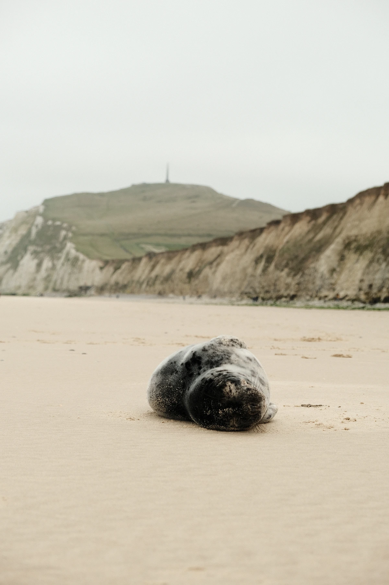</button>
          <figcaption class="plate__caption"><span class="plate__place">Cap Blanc-Nez, April 2026</span><span class="plate__settings"><span>44 mm</span><span>f/5</span><span>1/800 s</span><span>ISO 320</span></span></figcaption>
        </figure>
      </div>
      <div class="plate" style="--r:1.5">
        <figure class="plate__figure" style="--r:1.5" data-full="images/arluxis/landscape_photography/DSCF5883-2.jpg" data-exif="X-T30 II|XF27mm F2.8|f/5.6|1/1250 s|ISO 640">
          <button class="plate__open" type="button">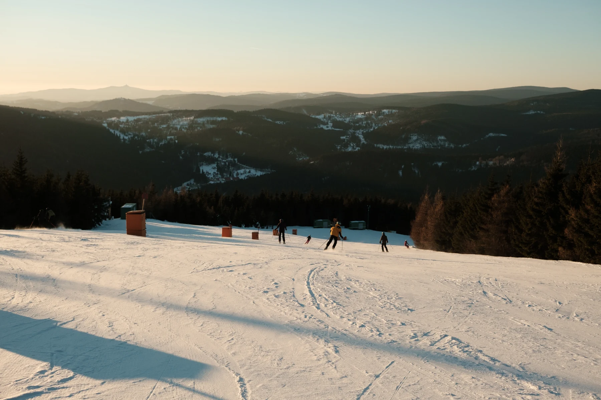</button>
          <figcaption class="plate__caption"><span class="plate__place">Harrachov, January 2026</span><span class="plate__settings"><span>27 mm</span><span>f/5.6</span><span>1/1250 s</span><span>ISO 640</span></span></figcaption>
        </figure>
      </div>
      <div class="plate" style="--r:1.5">
        <figure class="plate__figure" style="--r:1.5" data-full="images/arluxis/landscape_photography/DSCF4227.JPG" data-exif="X-T30 II|XF18-55mm F2.8-4|39 mm|f/3.6|1/550 s|ISO 640|Classic Negative">
          <button class="plate__open" type="button">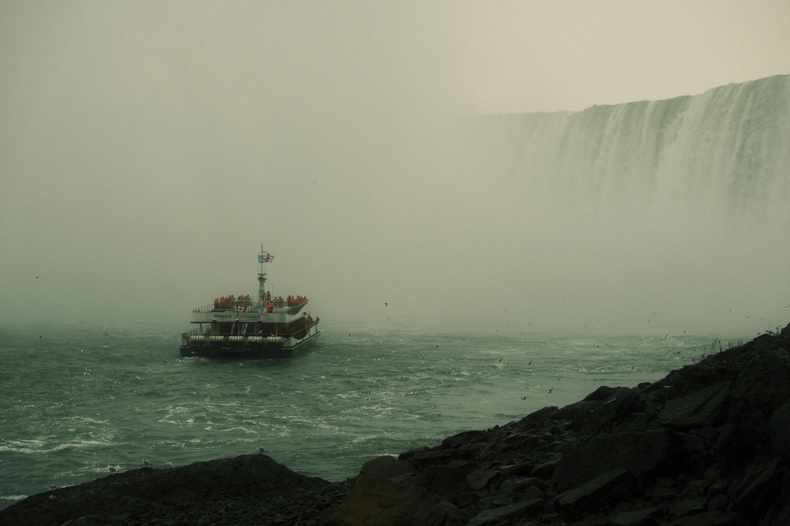</button>
          <figcaption class="plate__caption"><span class="plate__place">Toronto, November 2025</span><span class="plate__settings"><span>39 mm</span><span>f/3.6</span><span>1/550 s</span><span>ISO 640</span></span></figcaption>
        </figure>
      </div>
      <div class="plate" style="--r:0.6667">
        <figure class="plate__figure" style="--r:0.6667" data-full="images/arluxis/landscape_photography/DSCF2716.JPG" data-exif="X-T30 II|XF27mm F2.8|f/11|1/100 s|ISO 250">
          <button class="plate__open" type="button">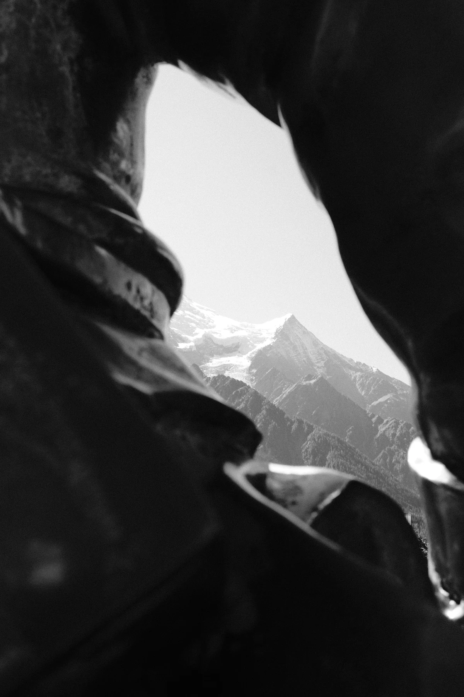</button>
          <figcaption class="plate__caption"><span class="plate__place">Chamonix, September 2025</span><span class="plate__settings"><span>27 mm</span><span>f/11</span><span>1/100 s</span><span>ISO 250</span></span></figcaption>
        </figure>
      </div>
      <div class="plate" style="--r:1.5">
        <figure class="plate__figure" style="--r:1.5" data-full="images/arluxis/landscape_photography/DSCF2601.JPG" data-exif="X-T30 II|XF27mm F2.8|f/10|1/1100 s|ISO 640|Classic Negative">
          <button class="plate__open" type="button">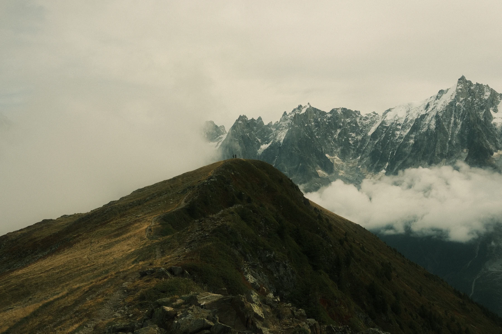</button>
          <figcaption class="plate__caption"><span class="plate__place">Chamonix, September 2025</span><span class="plate__settings"><span>27 mm</span><span>f/10</span><span>1/1100 s</span><span>ISO 640</span></span></figcaption>
        </figure>
      </div>
      <div class="plate" style="--r:1.5">
        <figure class="plate__figure" style="--r:1.5" data-full="images/arluxis/landscape_photography/DSCF2595.JPG" data-exif="X-T30 II|XF27mm F2.8|f/14|1/1600 s|ISO 640|Classic Negative">
          <button class="plate__open" type="button"></button>
          <figcaption class="plate__caption"><span class="plate__place">Chamonix, September 2025</span><span class="plate__settings"><span>27 mm</span><span>f/14</span><span>1/1600 s</span><span>ISO 640</span></span></figcaption>
        </figure>
      </div>
      <div class="plate" style="--r:1.5">
        <figure class="plate__figure" style="--r:1.5" data-full="images/arluxis/landscape_photography/DSCF0822.jpg" data-exif="X-T30 II|XF18-55mm F2.8-4|34 mm|f/10|1/240 s|ISO 160">
          <button class="plate__open" type="button">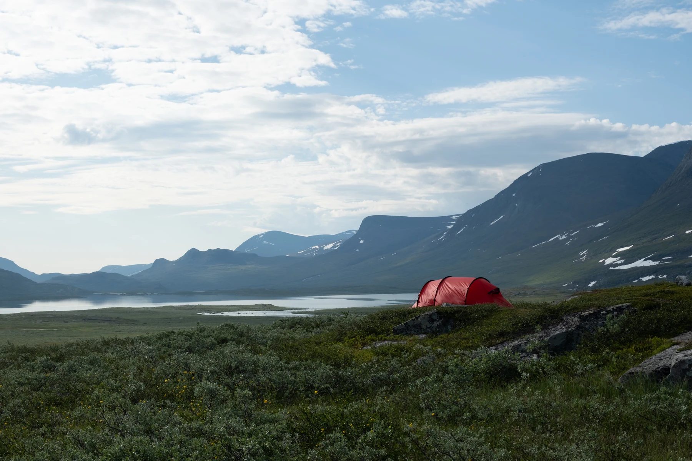</button>
          <figcaption class="plate__caption"><span class="plate__place">Kungsleden, July 2025</span><span class="plate__settings"><span>34 mm</span><span>f/10</span><span>1/240 s</span><span>ISO 160</span></span></figcaption>
        </figure>
      </div>
    <p class="chapter__end"><a href="#sports" data-gallery="sports">Next gallery: Sports</a><a href="#top">Back to top</a></p>
  </section>

  <!-- Sports -->
  <section class="chapter" id="sports" data-gallery="sports" aria-labelledby="sports-title">
    <header class="chapter__head">
      <h2 class="chapter__title" tabindex="-1" id="sports-title">Sports</h2>
    </header>
      <div class="plate" style="--r:1.5">
        <figure class="plate__figure" style="--r:1.5" data-full="images/arluxis/sports_photography/DSCF3159.JPG" data-exif="X-T30 II|XF27mm F2.8|f/10|1/1000 s|ISO 500|Classic Chrome">
          <button class="plate__open" type="button">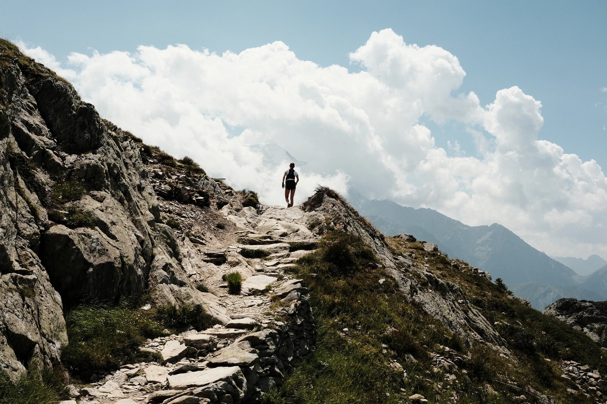</button>
          <figcaption class="plate__caption"><span class="plate__place">Chamonix, August 2026</span><span class="plate__settings"><span>27 mm</span><span>f/10</span><span>1/1000 s</span><span>ISO 500</span></span></figcaption>
        </figure>
      </div>
      <div class="plate plate--spread" style="--r:1.3334">
        <div class="plate__pair">
          <figure class="plate__figure" style="--r:0.6667" data-full="images/arluxis/sports_photography/DSCF2567.JPG" data-exif="X-T30 II|XF27mm F2.8|f/2.8|1/6400 s|ISO 400">
            <button class="plate__open" type="button">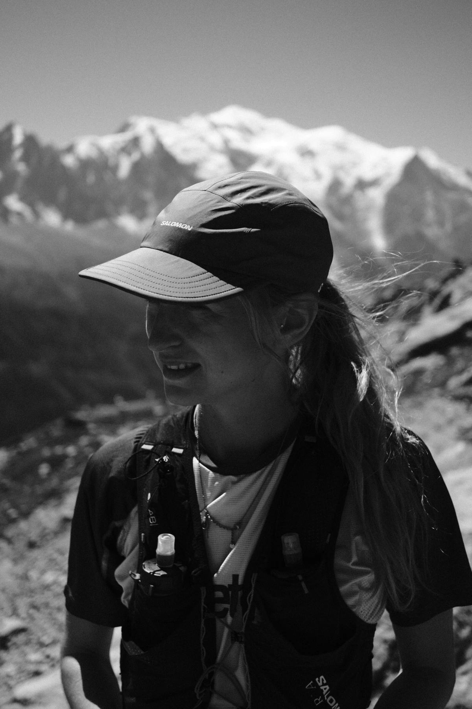</button>
            <figcaption class="plate__caption"><span class="plate__place">Chamonix, July 2026</span><span class="plate__settings"><span>27 mm</span><span>f/2.8</span><span>1/6400 s</span><span>ISO 400</span></span></figcaption>
          </figure>
          <figure class="plate__figure" style="--r:0.6667" data-full="images/arluxis/sports_photography/DSCF2892.JPG" data-exif="X-T30 II|XF27mm F2.8|f/4.5|1/2000 s|ISO 800|Classic Chrome">
            <button class="plate__open" type="button">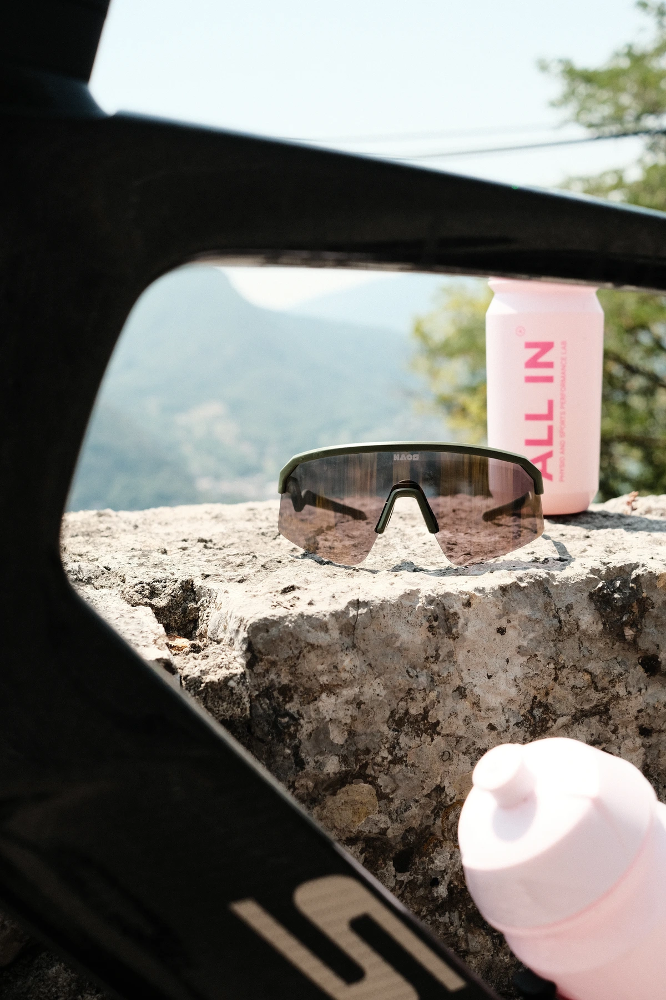</button>
            <figcaption class="plate__caption"><span class="plate__place">Chamonix, July 2026</span><span class="plate__settings"><span>27 mm</span><span>f/4.5</span><span>1/2000 s</span><span>ISO 800</span></span></figcaption>
          </figure>
        </div>
      </div>
      <div class="plate" style="--r:1.5">
        <figure class="plate__figure" style="--r:1.5" data-full="images/arluxis/sports_photography/DSCF8627.JPG" data-exif="X-T30 II|XF18-55mm F2.8-4|55 mm|f/5|1/500 s|ISO 400|Classic Chrome">
          <button class="plate__open" type="button">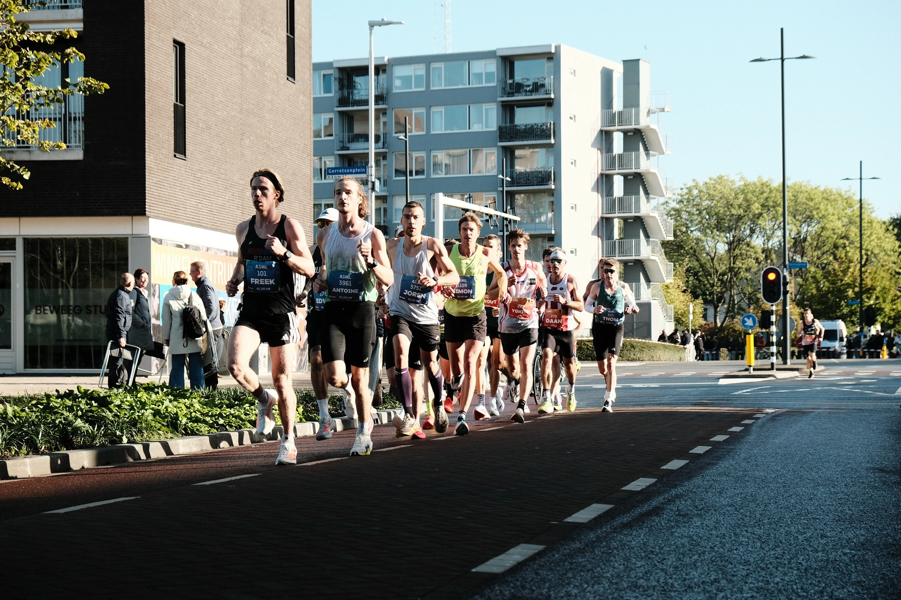</button>
          <figcaption class="plate__caption"><span class="plate__place">Eindhoven Marathon, October 2026</span><span class="plate__settings"><span>55 mm</span><span>f/5</span><span>1/500 s</span><span>ISO 400</span></span></figcaption>
        </figure>
      </div>
      <div class="plate plate--spread" style="--r:1.3334">
        <div class="plate__pair">
          <figure class="plate__figure" style="--r:0.6667" data-full="images/arluxis/sports_photography/DSCF8526.JPG" data-exif="X-T30 II|XF18-55mm F2.8-4|55 mm|f/4|1/180 s|ISO 400">
            <button class="plate__open" type="button">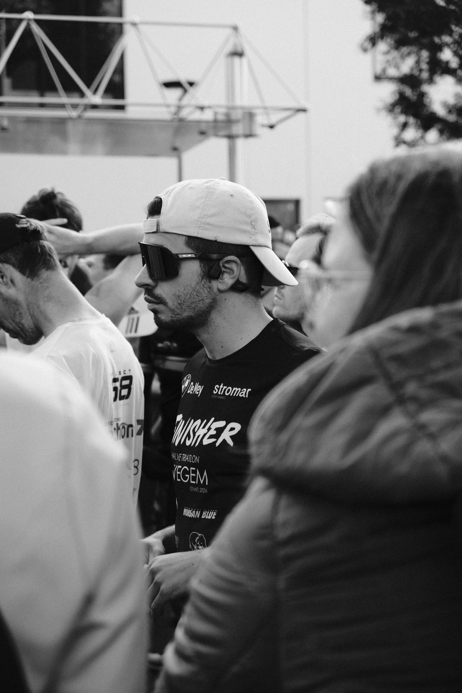</button>
            <figcaption class="plate__caption"><span class="plate__place">Eindhoven Marathon, October 2026</span><span class="plate__settings"><span>55 mm</span><span>f/4</span><span>1/180 s</span><span>ISO 400</span></span></figcaption>
          </figure>
          <figure class="plate__figure" style="--r:0.6667" data-full="images/arluxis/sports_photography/DSCF8490.JPG" data-exif="X-T30 II|XF18-55mm F2.8-4|33 mm|f/6.4|1/160 s|ISO 400|Classic Chrome">
            <button class="plate__open" type="button">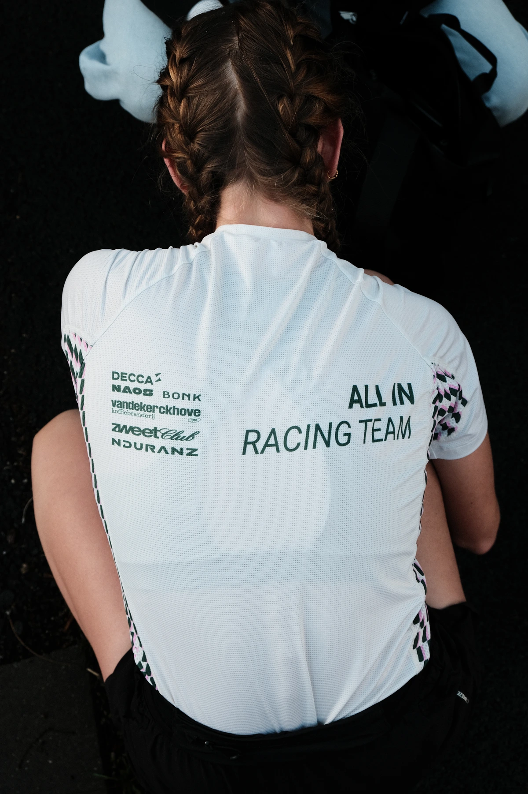</button>
            <figcaption class="plate__caption"><span class="plate__place">Eindhoven Marathon, October 2026</span><span class="plate__settings"><span>33 mm</span><span>f/6.4</span><span>1/160 s</span><span>ISO 400</span></span></figcaption>
          </figure>
        </div>
      </div>
      <div class="plate" style="--r:0.6667">
        <figure class="plate__figure" style="--r:0.6667" data-full="images/arluxis/sports_photography/DSCF3540.JPG" data-exif="X-T30 II|XF18-55mm F2.8-4|55 mm|f/22|1/8 s|ISO 160|Eterna">
          <button class="plate__open" type="button">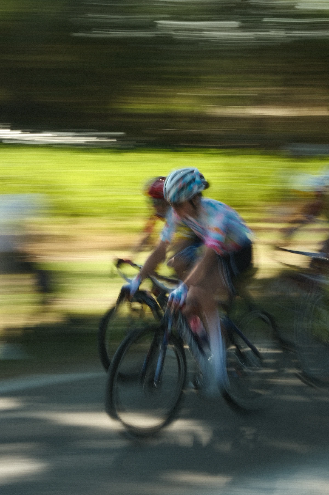</button>
          <figcaption class="plate__caption"><span class="plate__place">Tour de France Femmes, August 2026</span><span class="plate__settings"><span>55 mm</span><span>f/22</span><span>1/8 s</span><span>ISO 160</span></span></figcaption>
        </figure>
      </div>
      <div class="plate" style="--r:1.5">
        <figure class="plate__figure" style="--r:1.5" data-full="images/arluxis/sports_photography/DSCF9763.JPG" data-exif="X-T30 II|XF18-55mm F2.8-4|55 mm|f/22|1/30 s|ISO 320|Classic Chrome">
          <button class="plate__open" type="button">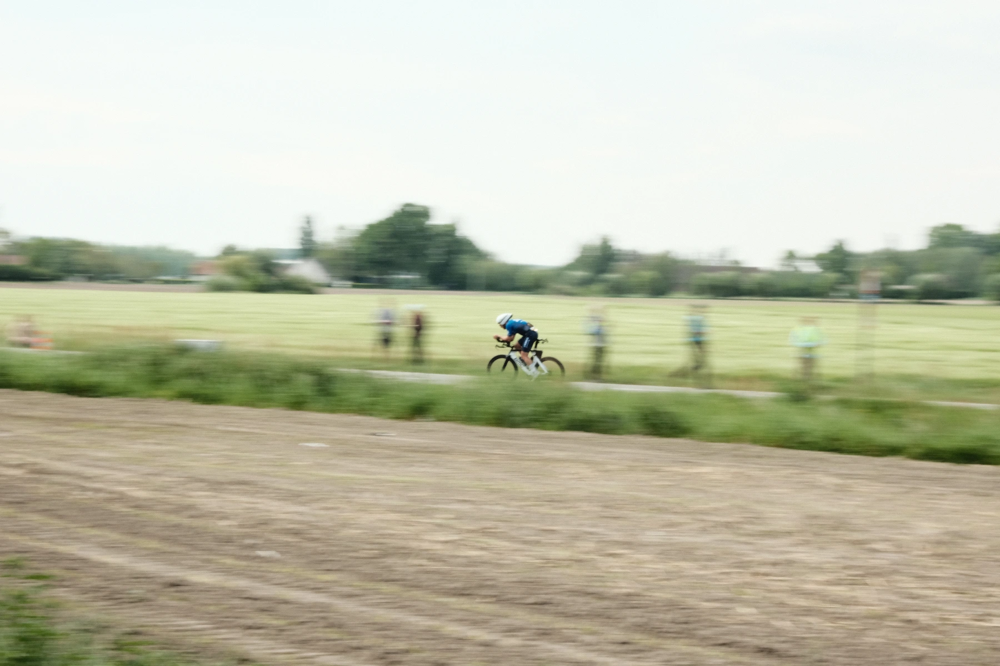</button>
          <figcaption class="plate__caption"><span class="plate__place">Triathlon Lievegem, May 2026</span><span class="plate__settings"><span>55 mm</span><span>f/22</span><span>1/30 s</span><span>ISO 320</span></span></figcaption>
        </figure>
      </div>
      <div class="plate plate--spread" style="--r:1.3334">
        <div class="plate__pair">
          <figure class="plate__figure" style="--r:0.6667" data-full="images/arluxis/sports_photography/DSCF9876.JPG" data-exif="X-T30 II|XF18-55mm F2.8-4|55 mm|f/22|1/60 s|ISO 500">
            <button class="plate__open" type="button">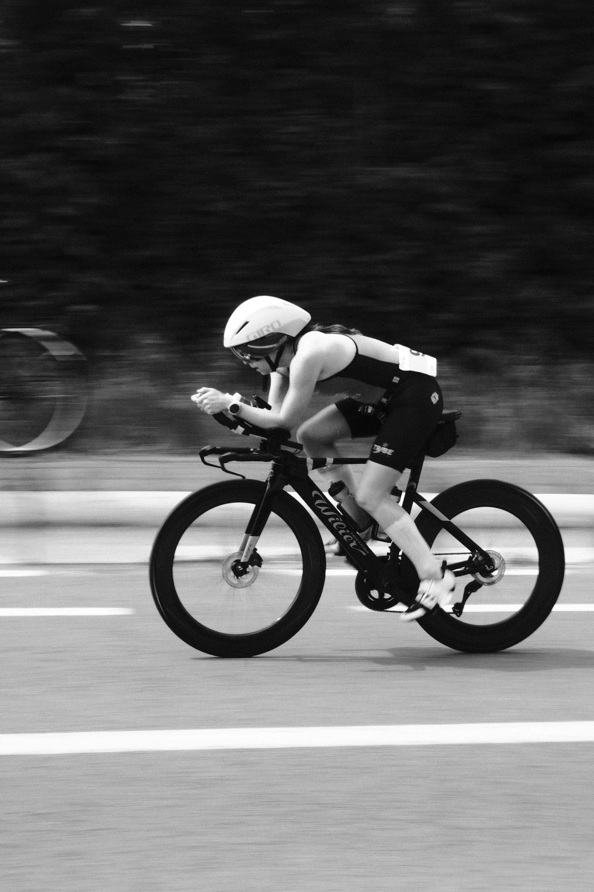</button>
            <figcaption class="plate__caption"><span class="plate__place">Triathlon Lievegem, May 2026</span><span class="plate__settings"><span>55 mm</span><span>f/22</span><span>1/60 s</span><span>ISO 500</span></span></figcaption>
          </figure>
          <figure class="plate__figure" style="--r:0.6667" data-full="images/arluxis/sports_photography/DSCF9710.JPG" data-exif="X-T30 II|XF18-55mm F2.8-4|32 mm|f/11|1/2000 s|ISO 3200|Classic Chrome">
            <button class="plate__open" type="button">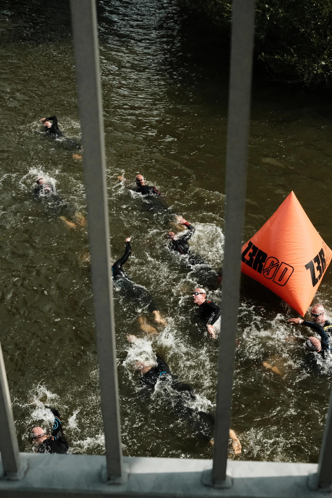</button>
            <figcaption class="plate__caption"><span class="plate__place">Triathlon Lievegem, May 2026</span><span class="plate__settings"><span>32 mm</span><span>f/11</span><span>1/2000 s</span><span>ISO 3200</span></span></figcaption>
          </figure>
        </div>
      </div>
      <div class="plate plate--spread" style="--r:1.3334">
        <div class="plate__pair">
          <figure class="plate__figure" style="--r:0.6667" data-full="images/arluxis/sports_photography/DSCF8840.JPG" data-exif="X-T30 II|XF18-55mm F2.8-4|55 mm|f/4|1/60 s|ISO 3200|Classic Chrome">
            <button class="plate__open" type="button">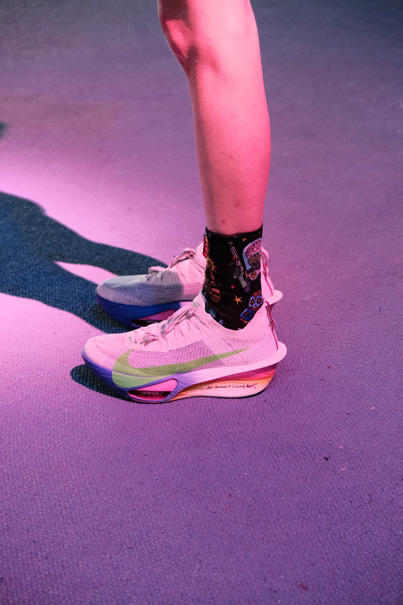</button>
            <figcaption class="plate__caption"><span class="plate__place">Ghent Marathon, March 2026</span><span class="plate__settings"><span>55 mm</span><span>f/4</span><span>1/60 s</span><span>ISO 3200</span></span></figcaption>
          </figure>
          <figure class="plate__figure" style="--r:0.6667" data-full="images/arluxis/sports_photography/DSCF8837.JPG" data-exif="X-T30 II|XF18-55mm F2.8-4|53 mm|f/4|1/60 s|ISO 3200|Classic Chrome">
            <button class="plate__open" type="button"></button>
            <figcaption class="plate__caption"><span class="plate__place">Ghent Marathon, March 2026</span><span class="plate__settings"><span>53 mm</span><span>f/4</span><span>1/60 s</span><span>ISO 3200</span></span></figcaption>
          </figure>
        </div>
      </div>
      <div class="plate" style="--r:0.6667">
        <figure class="plate__figure" style="--r:0.6667" data-full="images/arluxis/sports_photography/DSCF8051.JPG" data-exif="X-T30 II|XF18-55mm F2.8-4|32 mm|f/20|1/30 s|ISO 320|Classic Chrome">
          <button class="plate__open" type="button">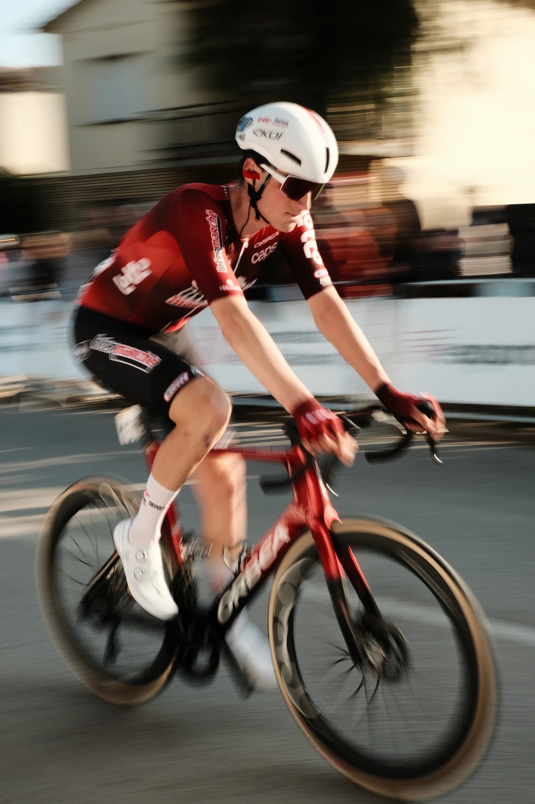</button>
          <figcaption class="plate__caption"><span class="plate__place">Volta a Catalunya, March 2026</span><span class="plate__settings"><span>32 mm</span><span>f/20</span><span>1/30 s</span><span>ISO 320</span></span></figcaption>
        </figure>
      </div>
      <div class="plate" style="--r:1.3333">
        <figure class="plate__figure" style="--r:1.3333" data-full="images/arluxis/sports_photography/DSCF4309-2.jpg" data-exif="X-T30 II|XF18-55mm F2.8-4|55 mm|f/4|1/160 s|ISO 250">
          <button class="plate__open" type="button"></button>
          <figcaption class="plate__caption"><span class="plate__place">Kings vs Maple Leafs, November 2025</span><span class="plate__settings"><span>55 mm</span><span>f/4</span><span>1/160 s</span><span>ISO 250</span></span></figcaption>
        </figure>
      </div>
      <div class="plate" style="--r:1.5">
        <figure class="plate__figure" style="--r:1.5" data-full="images/arluxis/sports_photography/DSCF3586.jpg" data-exif="X-T30 II|XF18-55mm F2.8-4|41 mm|f/5.6|1/900 s|ISO 320">
          <button class="plate__open" type="button">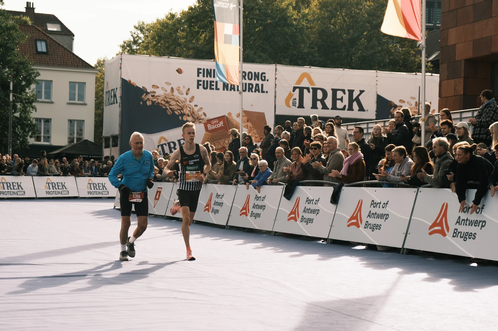</button>
          <figcaption class="plate__caption"><span class="plate__place">Antwerp Marathon, October 2025</span><span class="plate__settings"><span>41 mm</span><span>f/5.6</span><span>1/900 s</span><span>ISO 320</span></span></figcaption>
        </figure>
      </div>
      <div class="plate" style="--r:1.5">
        <figure class="plate__figure" style="--r:1.5" data-full="images/arluxis/sports_photography/DSCF1175.JPG" data-exif="X-T30 II|XF18-55mm F2.8-4|55 mm|f/8|1/500 s|ISO 500">
          <button class="plate__open" type="button">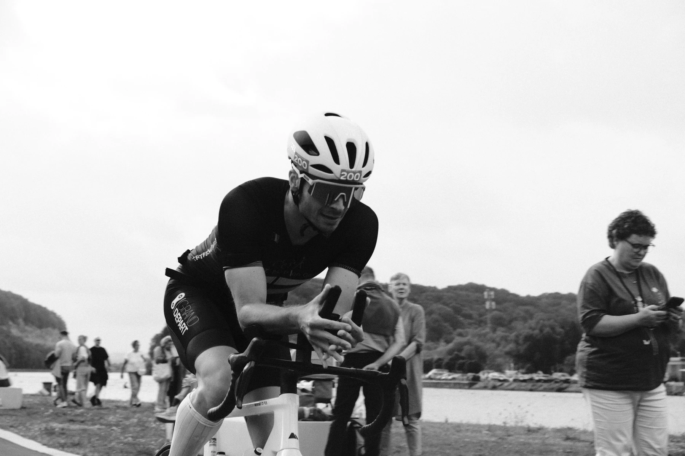</button>
          <figcaption class="plate__caption"><span class="plate__place">The Cave Triathlon, July 2025</span><span class="plate__settings"><span>55 mm</span><span>f/8</span><span>1/500 s</span><span>ISO 500</span></span></figcaption>
        </figure>
      </div>
      <div class="plate" style="--r:1.5">
        <figure class="plate__figure" style="--r:1.5" data-full="images/arluxis/sports_photography/DSCF1152.JPG" data-exif="X-T30 II|XF18-55mm F2.8-4|50 mm|f/7.1|1/4000 s|ISO 3200">
          <button class="plate__open" type="button">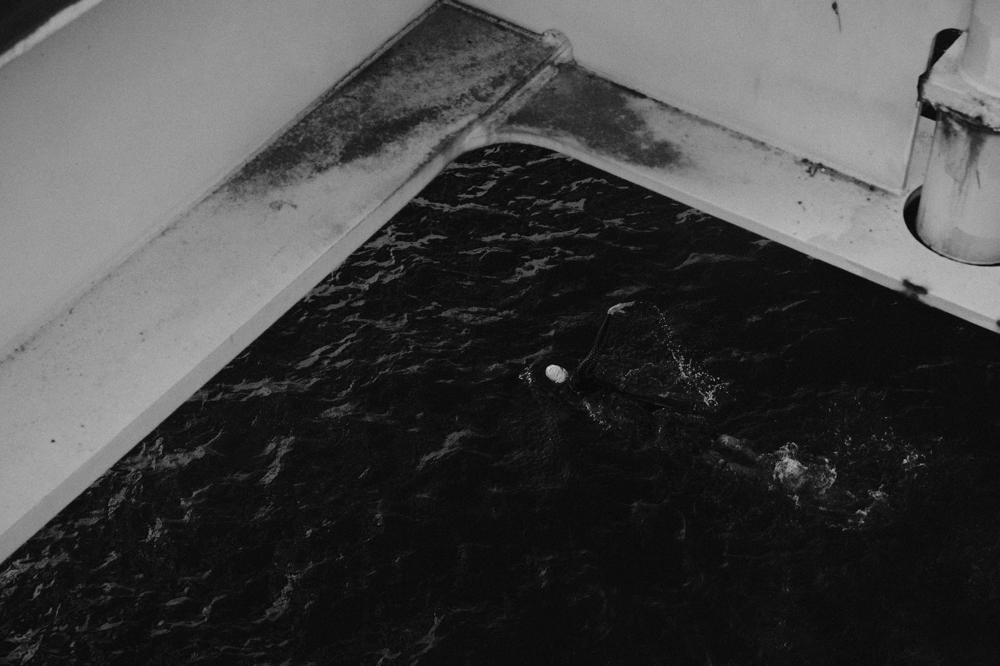</button>
          <figcaption class="plate__caption"><span class="plate__place">The Cave Triathlon, July 2025</span><span class="plate__settings"><span>50 mm</span><span>f/7.1</span><span>1/4000 s</span><span>ISO 3200</span></span></figcaption>
        </figure>
      </div>
    <p class="chapter__end"><a href="#street" data-gallery="street">Next gallery: Street</a><a href="#top">Back to top</a></p>
  </section>

  <!-- Street -->
  <section class="chapter" id="street" data-gallery="street" aria-labelledby="street-title">
    <header class="chapter__head">
      <h2 class="chapter__title" tabindex="-1" id="street-title">Street</h2>
    </header>
      <div class="plate" style="--r:0.6667">
        <figure class="plate__figure" style="--r:0.6667" data-full="images/arluxis/street_photography/DSCF9160.JPG" data-exif="X-T30 II|XF18-55mm F2.8-4|46 mm|f/5|1/500 s|ISO 800">
          <button class="plate__open" type="button"></button>
          <figcaption class="plate__caption"><span class="plate__place">Friesland, October 2026</span><span class="plate__settings"><span>46 mm</span><span>f/5</span><span>1/500 s</span><span>ISO 800</span></span></figcaption>
        </figure>
      </div>
      <div class="plate plate--spread" style="--r:1.3334">
        <div class="plate__pair">
          <figure class="plate__figure" style="--r:0.6667" data-full="images/arluxis/street_photography/DSCF7981.JPG" data-exif="X-T30 II|XF18-55mm F2.8-4|29 mm|f/8|1/2000 s|ISO 800">
            <button class="plate__open" type="button">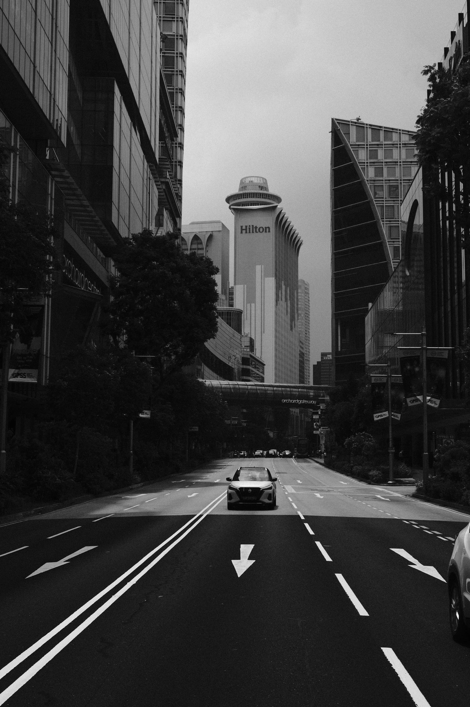</button>
            <figcaption class="plate__caption"><span class="plate__place">Singapore, October 2026</span><span class="plate__settings"><span>29 mm</span><span>f/8</span><span>1/2000 s</span><span>ISO 800</span></span></figcaption>
          </figure>
          <figure class="plate__figure" style="--r:0.6667" data-full="images/arluxis/street_photography/DSCF7784.JPG" data-exif="X-T30 II|XF27mm F2.8|f/5|1/1000 s|ISO 800|Classic Chrome">
            <button class="plate__open" type="button">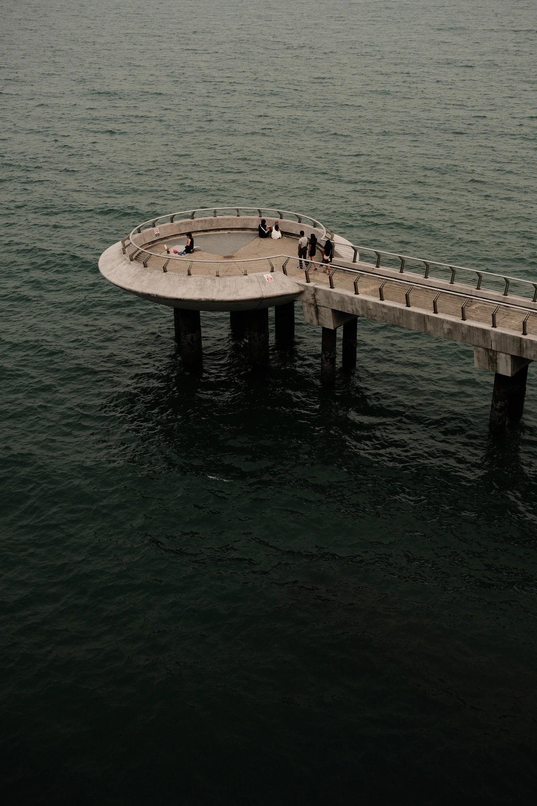</button>
            <figcaption class="plate__caption"><span class="plate__place">Singapore, September 2026</span><span class="plate__settings"><span>27 mm</span><span>f/5</span><span>1/1000 s</span><span>ISO 800</span></span></figcaption>
          </figure>
        </div>
      </div>
      <div class="plate" style="--r:1.5">
        <figure class="plate__figure" style="--r:1.5" data-full="images/arluxis/street_photography/DSCF7706.JPG" data-exif="X-T30 II|XF27mm F2.8|f/7.1|1/1000 s|ISO 800|Classic Chrome">
          <button class="plate__open" type="button">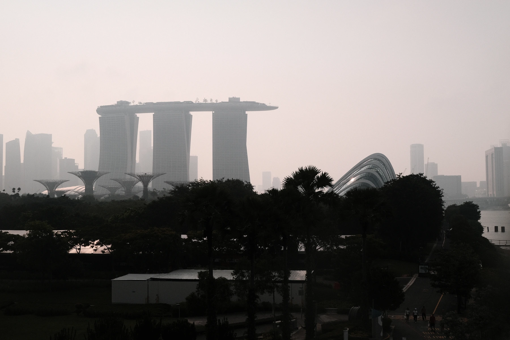</button>
          <figcaption class="plate__caption"><span class="plate__place">Singapore, September 2026</span><span class="plate__settings"><span>27 mm</span><span>f/7.1</span><span>1/1000 s</span><span>ISO 800</span></span></figcaption>
        </figure>
      </div>
      <div class="plate" style="--r:0.6667">
        <figure class="plate__figure" style="--r:0.6667" data-full="images/arluxis/street_photography/DSCF4573.JPG" data-exif="X-T30 II|XF27mm F2.8|f/5|1/340 s|ISO 160">
          <button class="plate__open" type="button">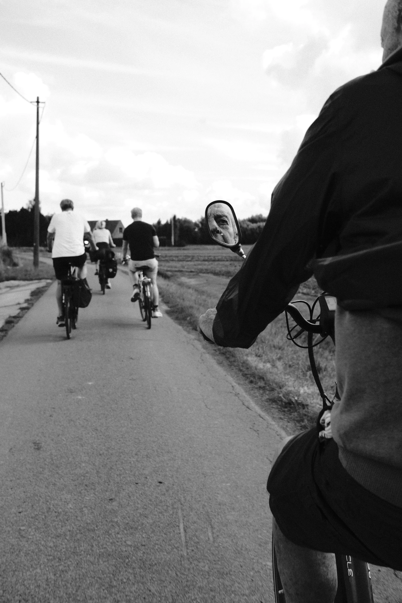</button>
          <figcaption class="plate__caption"><span class="plate__place">Damme, August 2026</span><span class="plate__settings"><span>27 mm</span><span>f/5</span><span>1/340 s</span><span>ISO 160</span></span></figcaption>
        </figure>
      </div>
      <div class="plate" style="--r:0.6667">
        <figure class="plate__figure" style="--r:0.6667" data-full="images/arluxis/street_photography/DSCF3322.JPG" data-exif="X-T30 II|XF18-55mm F2.8-4|50 mm|f/9|1/250 s|ISO 640|Classic Negative">
          <button class="plate__open" type="button">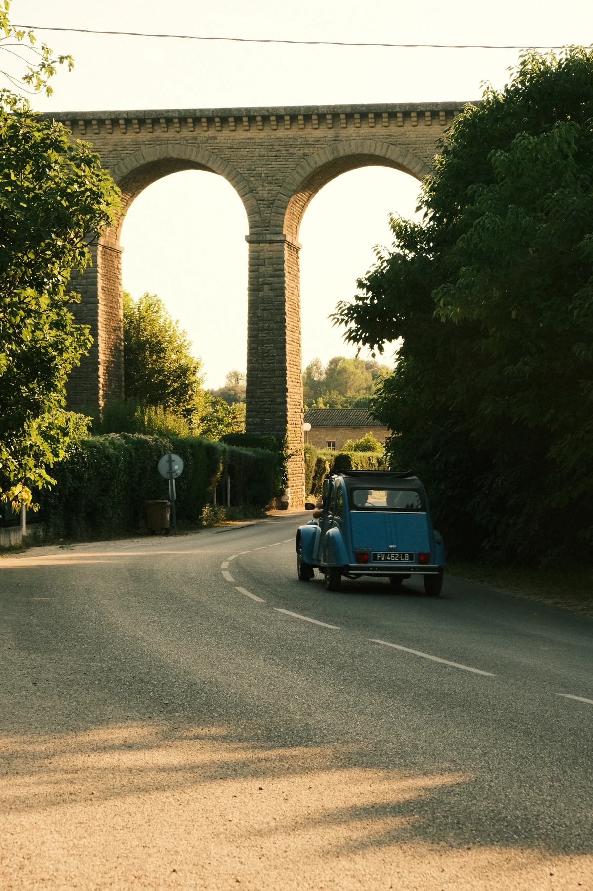</button>
          <figcaption class="plate__caption"><span class="plate__place">Carpentras, August 2026</span><span class="plate__settings"><span>50 mm</span><span>f/9</span><span>1/250 s</span><span>ISO 640</span></span></figcaption>
        </figure>
      </div>
      <div class="plate plate--spread" style="--r:1.3334">
        <div class="plate__pair">
          <figure class="plate__figure" style="--r:0.6667" data-full="images/arluxis/street_photography/DSCF1969.JPG" data-exif="X-T30 II|XF18-55mm F2.8-4|55 mm|f/4|1/500 s|ISO 12800|Classic Chrome">
            <button class="plate__open" type="button"></button>
            <figcaption class="plate__caption"><span class="plate__place">Friesland, July 2026</span><span class="plate__settings"><span>55 mm</span><span>f/4</span><span>1/500 s</span><span>ISO 12800</span></span></figcaption>
          </figure>
          <figure class="plate__figure" style="--r:0.6667" data-full="images/arluxis/street_photography/DSCF1632.JPG" data-exif="X-T30 II|XF18-55mm F2.8-4|55 mm|f/6.4|1/500 s|ISO 3200">
            <button class="plate__open" type="button">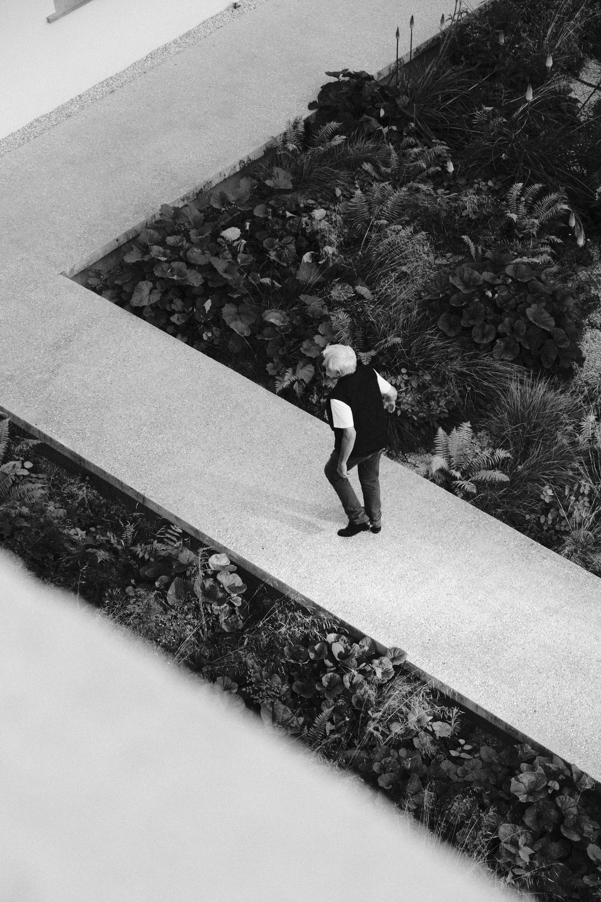</button>
            <figcaption class="plate__caption"><span class="plate__place">Friesland, July 2026</span><span class="plate__settings"><span>55 mm</span><span>f/6.4</span><span>1/500 s</span><span>ISO 3200</span></span></figcaption>
          </figure>
        </div>
      </div>
      <div class="plate" style="--r:0.6667">
        <figure class="plate__figure" style="--r:0.6667" data-full="images/arluxis/street_photography/DSCF9170.JPG" data-exif="X-T30 II|XF27mm F2.8|f/7.1|1/2000 s|ISO 800|Classic Negative">
          <button class="plate__open" type="button"></button>
          <figcaption class="plate__caption"><span class="plate__place">Rotterdam, April 2026</span><span class="plate__settings"><span>27 mm</span><span>f/7.1</span><span>1/2000 s</span><span>ISO 800</span></span></figcaption>
        </figure>
      </div>
      <div class="plate" style="--r:1.5">
        <figure class="plate__figure" style="--r:1.5" data-full="images/arluxis/street_photography/DSCF7927.JPG" data-exif="X-T30 II|XF18-55mm F2.8-4|18 mm|f/8|1/1000 s|ISO 1000|Classic Chrome">
          <button class="plate__open" type="button">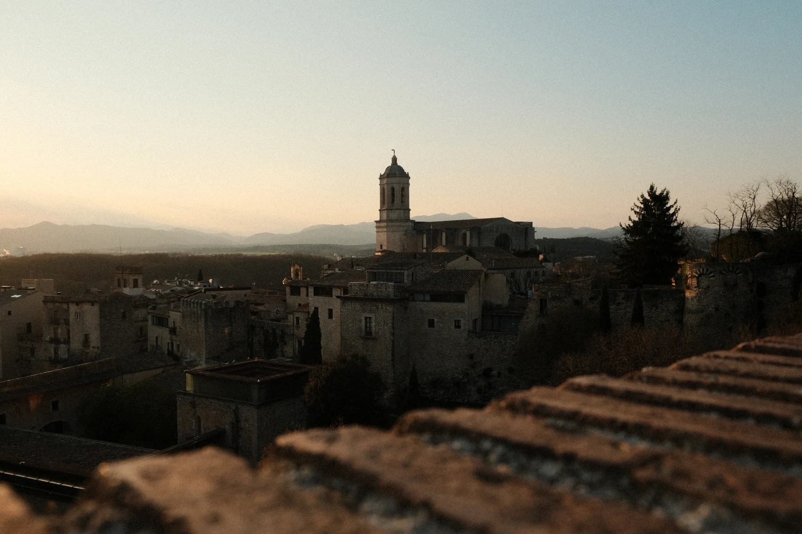</button>
          <figcaption class="plate__caption"><span class="plate__place">Girona, March 2026</span><span class="plate__settings"><span>18 mm</span><span>f/8</span><span>1/1000 s</span><span>ISO 1000</span></span></figcaption>
        </figure>
      </div>
      <div class="plate" style="--r:0.6667">
        <figure class="plate__figure" style="--r:0.6667" data-full="images/arluxis/street_photography/DSCF7713.JPG" data-exif="X-T30 II|XF18-55mm F2.8-4|32 mm|f/8|1/1000 s|ISO 320|Classic Negative">
          <button class="plate__open" type="button"></button>
          <figcaption class="plate__caption"><span class="plate__place">Girona, March 2026</span><span class="plate__settings"><span>32 mm</span><span>f/8</span><span>1/1000 s</span><span>ISO 320</span></span></figcaption>
        </figure>
      </div>
      <div class="plate plate--spread" style="--r:1.3334">
        <div class="plate__pair">
          <figure class="plate__figure" style="--r:0.6667" data-full="images/arluxis/street_photography/DSCF4010.JPG" data-exif="X-T30 II|XF27mm F2.8|f/2.8|1/1300 s|ISO 640|Classic Negative">
            <button class="plate__open" type="button">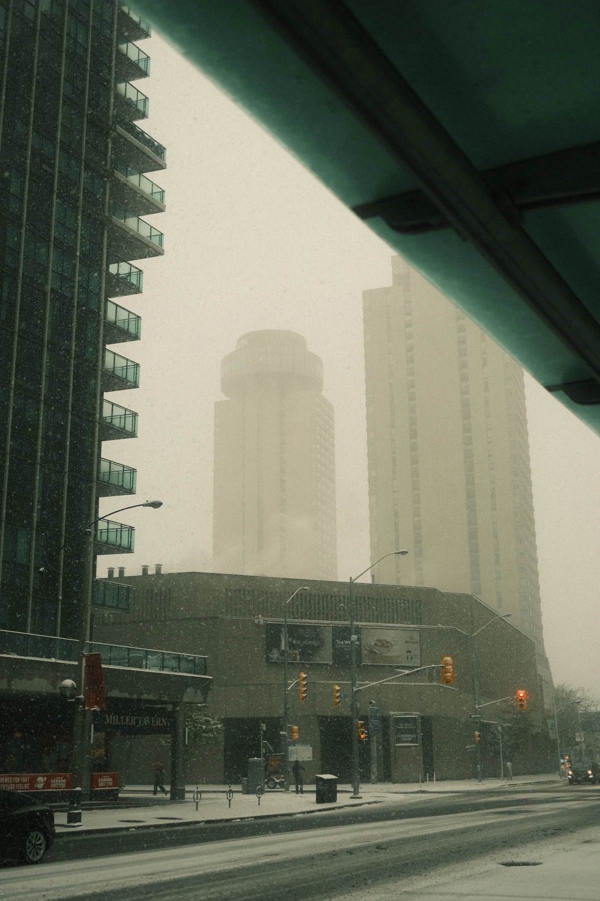</button>
            <figcaption class="plate__caption"><span class="plate__place">Toronto, November 2025</span><span class="plate__settings"><span>27 mm</span><span>f/2.8</span><span>1/1300 s</span><span>ISO 640</span></span></figcaption>
          </figure>
          <figure class="plate__figure" style="--r:0.6667" data-full="images/arluxis/street_photography/DSCF4003.JPG" data-exif="X-T30 II|XF27mm F2.8|f/2.8|1/250 s|ISO 640|Classic Negative">
            <button class="plate__open" type="button">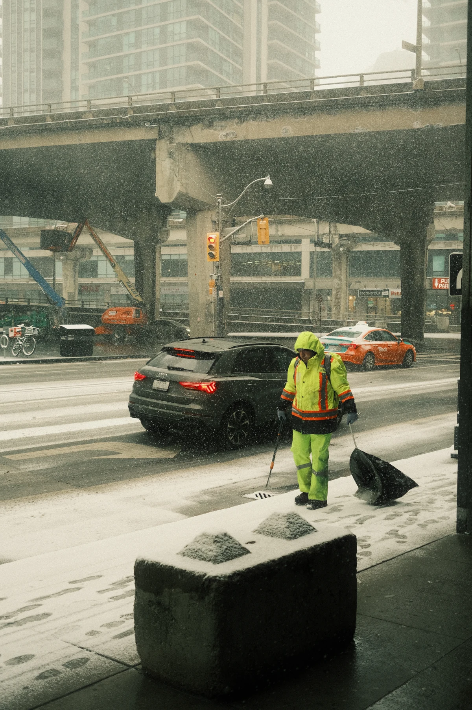</button>
            <figcaption class="plate__caption"><span class="plate__place">Toronto, November 2025</span><span class="plate__settings"><span>27 mm</span><span>f/2.8</span><span>1/250 s</span><span>ISO 640</span></span></figcaption>
          </figure>
        </div>
      </div>
      <div class="plate" style="--r:0.75">
        <figure class="plate__figure" style="--r:0.75" data-full="images/arluxis/street_photography/DSCF3907.jpg" data-exif="X-T30 II|XF27mm F2.8|f/3.6|1/100 s|ISO 320">
          <button class="plate__open" type="button">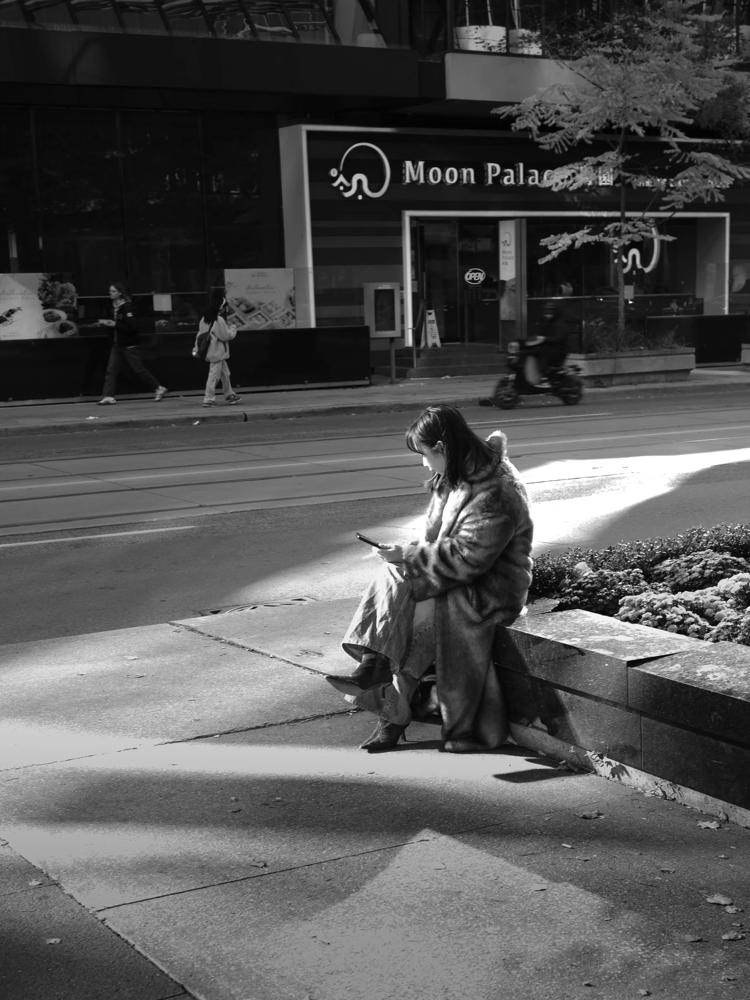</button>
          <figcaption class="plate__caption"><span class="plate__place">Toronto, November 2025</span><span class="plate__settings"><span>27 mm</span><span>f/3.6</span><span>1/100 s</span><span>ISO 320</span></span></figcaption>
        </figure>
      </div>
      <div class="plate" style="--r:0.6667">
        <figure class="plate__figure" style="--r:0.6667" data-full="images/arluxis/street_photography/DSCF2414.JPG" data-exif="X-T30 II|XF18-55mm F2.8-4|55 mm|f/5.6|1/1000 s|ISO 640|Classic Negative">
          <button class="plate__open" type="button">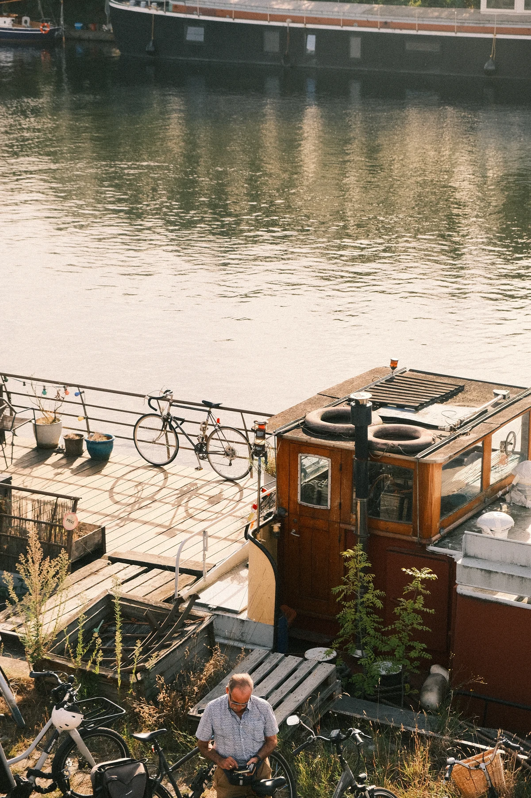</button>
          <figcaption class="plate__caption"><span class="plate__place">Ghent, September 2025</span><span class="plate__settings"><span>55 mm</span><span>f/5.6</span><span>1/1000 s</span><span>ISO 640</span></span></figcaption>
        </figure>
      </div>
    <p class="chapter__end"><a href="#nature" data-gallery="nature">Next gallery: Nature</a><a href="#top">Back to top</a></p>
  </section>

</div>
```
