```{=html}
<a class="skip" href="#galleries">Skip to galleries</a>

<nav class="topline" id="top" aria-label="Site">
  <a class="topline__link" href="index.html">Back to main site</a>
  
  <a class="topline__link topline__link--end" href="https://www.instagram.com/arluxis/" target="_blank" rel="noopener">Instagram</a>
</nav>

<header class="title-page">
  <h1 class="title-page__title">ARLUXIS</h1>
  <p class="title-page__byline">Photographs by Arthur Declercq</p>
  <figure class="frontispiece">
    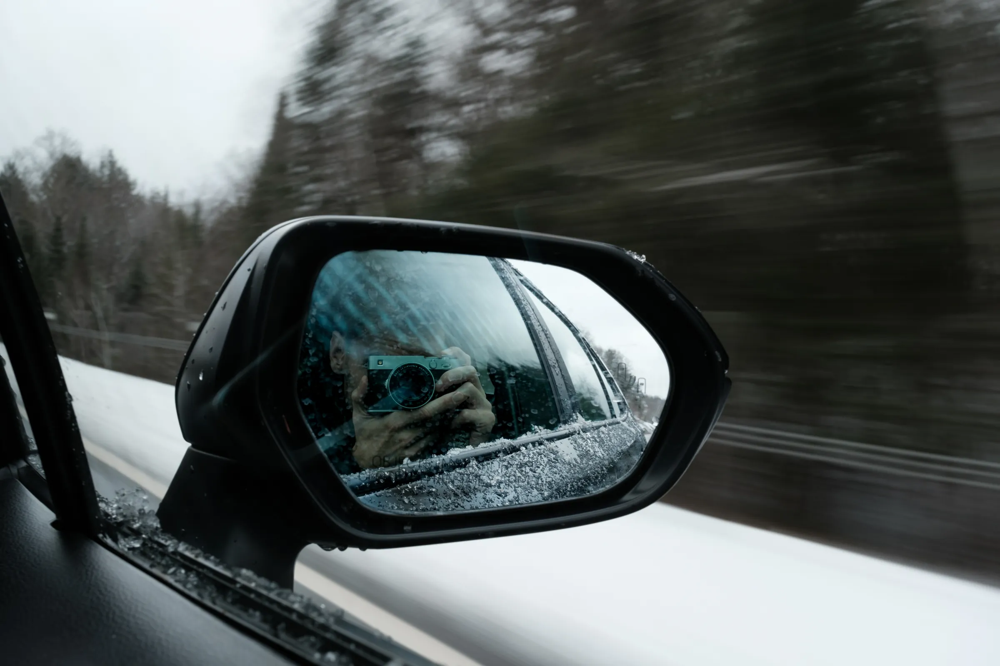
  </figure>
</header>

<nav class="galleries" id="galleries" aria-label="Galleries">
  <div class="galleries__inner">
    <a class="galleries__link" href="#landscape" data-gallery="landscape">Landscape<span class="galleries__count">13</span></a>
    <a class="galleries__link" href="#sports" data-gallery="sports">Sports<span class="galleries__count">14</span></a>
    <a class="galleries__link" href="#street" data-gallery="street">Street<span class="galleries__count">17</span></a>
  </div>
</nav>

<div role="main">

  <!-- Landscape -->
  <section class="chapter" id="landscape" data-gallery="landscape" aria-labelledby="landscape-title">
    <header class="chapter__head">
      <h2 class="chapter__title" tabindex="-1" id="landscape-title">Landscape</h2>
      <p class="chapter__places">Kungsleden, Chamonix, Toronto, Harrachov</p>
    </header>
      <div class="plate" style="--r:1.5">
        <figure class="plate__figure" style="--r:1.5" data-full="images/arluxis/landscape_photography/DSCF0336.jpg" data-exif="X-T30 II|XF18-55mm F2.8-4|25 mm|f/5.6|1/250 s|ISO 160">
          <button class="plate__open" type="button">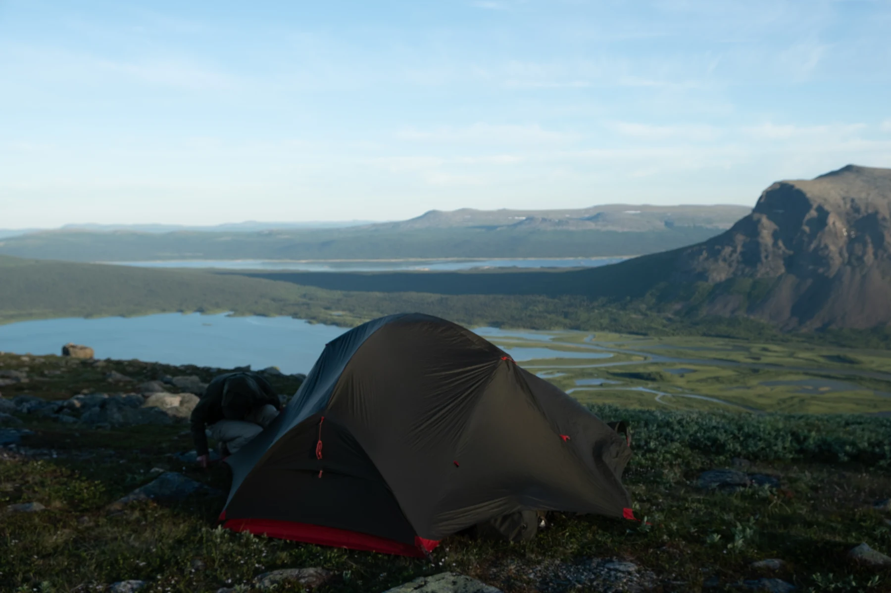</button>
          <figcaption class="plate__caption"><span class="plate__place">Kungsleden, July 2025</span><span class="plate__settings"><span>25 mm</span><span>f/5.6</span><span>1/250 s</span><span>ISO 160</span></span></figcaption>
        </figure>
      </div>
      <div class="plate" style="--r:1.5">
        <figure class="plate__figure" style="--r:1.5" data-full="images/arluxis/landscape_photography/DSCF0451.jpg" data-exif="X-T30 II|XF18-55mm F2.8-4|55 mm|f/4|1/850 s|ISO 160">
          <button class="plate__open" type="button">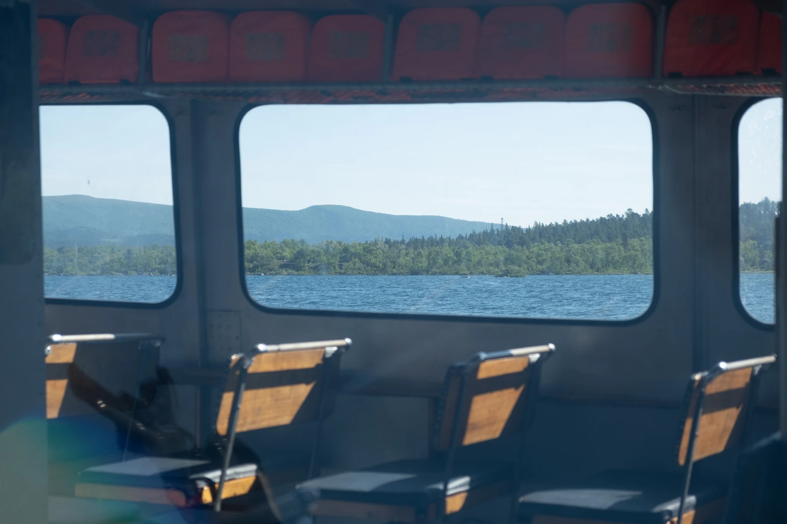</button>
          <figcaption class="plate__caption"><span class="plate__place">Kungsleden, July 2025</span><span class="plate__settings"><span>55 mm</span><span>f/4</span><span>1/850 s</span><span>ISO 160</span></span></figcaption>
        </figure>
      </div>
      <div class="plate" style="--r:1.5">
        <figure class="plate__figure" style="--r:1.5" data-full="images/arluxis/landscape_photography/DSCF0671.jpg" data-exif="X-T30 II|XF18-55mm F2.8-4|55 mm|f/9|1/480 s|ISO 160">
          <button class="plate__open" type="button">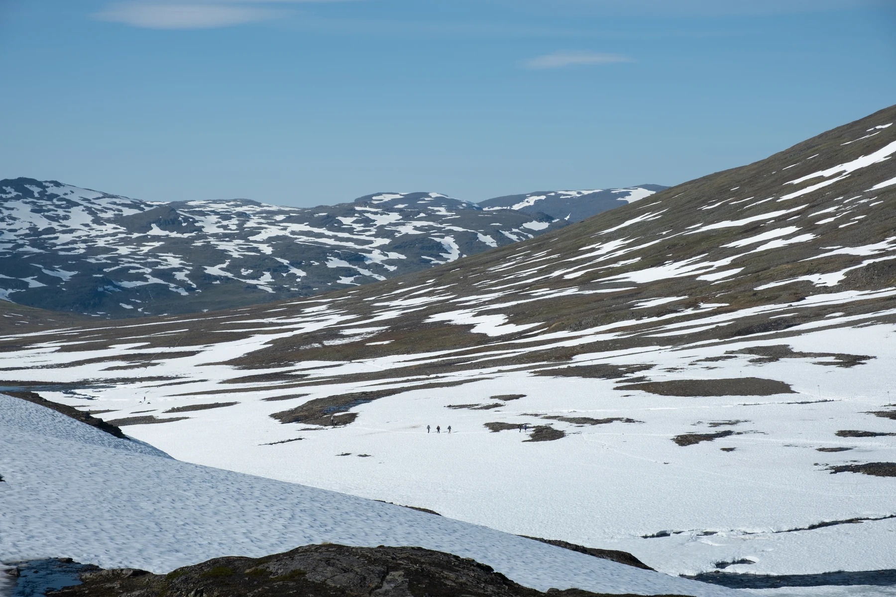</button>
          <figcaption class="plate__caption"><span class="plate__place">Kungsleden, July 2025</span><span class="plate__settings"><span>55 mm</span><span>f/9</span><span>1/480 s</span><span>ISO 160</span></span></figcaption>
        </figure>
      </div>
      <div class="plate" style="--r:1.5">
        <figure class="plate__figure" style="--r:1.5" data-full="images/arluxis/landscape_photography/DSCF0822.jpg" data-exif="X-T30 II|XF18-55mm F2.8-4|34 mm|f/10|1/240 s|ISO 160">
          <button class="plate__open" type="button"></button>
          <figcaption class="plate__caption"><span class="plate__place">Kungsleden, July 2025</span><span class="plate__settings"><span>34 mm</span><span>f/10</span><span>1/240 s</span><span>ISO 160</span></span></figcaption>
        </figure>
      </div>
      <div class="plate" style="--r:0.6667">
        <figure class="plate__figure" style="--r:0.6667" data-full="images/arluxis/landscape_photography/DSCF0928.jpg" data-exif="X-T30 II|XF18-55mm F2.8-4|39 mm|f/7.1|1/4000 s|ISO 400">
          <button class="plate__open" type="button">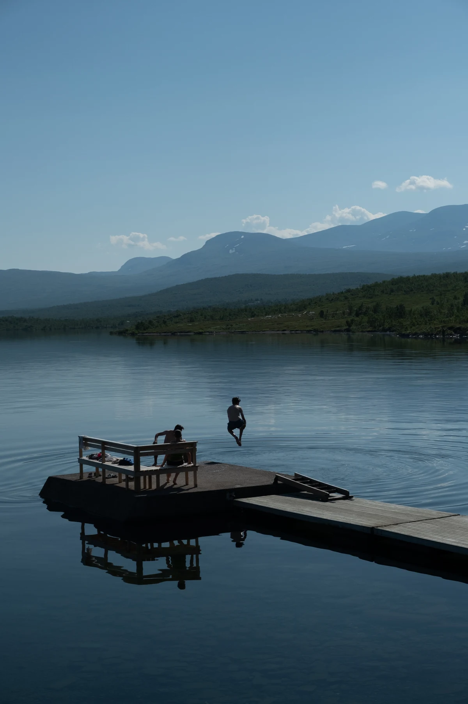</button>
          <figcaption class="plate__caption"><span class="plate__place">Kungsleden, July 2025</span><span class="plate__settings"><span>39 mm</span><span>f/7.1</span><span>1/4000 s</span><span>ISO 400</span></span></figcaption>
        </figure>
      </div>
      <div class="plate" style="--r:1.5">
        <figure class="plate__figure" style="--r:1.5" data-full="images/arluxis/landscape_photography/DSCF2595.JPG" data-exif="X-T30 II|XF27mm F2.8|f/14|1/1600 s|ISO 640|Classic Negative">
          <button class="plate__open" type="button"></button>
          <figcaption class="plate__caption"><span class="plate__place">Chamonix, September 2025</span><span class="plate__settings"><span>27 mm</span><span>f/14</span><span>1/1600 s</span><span>ISO 640</span></span></figcaption>
        </figure>
      </div>
      <div class="plate" style="--r:1.5">
        <figure class="plate__figure" style="--r:1.5" data-full="images/arluxis/landscape_photography/DSCF2601.JPG" data-exif="X-T30 II|XF27mm F2.8|f/10|1/1100 s|ISO 640|Classic Negative">
          <button class="plate__open" type="button"></button>
          <figcaption class="plate__caption"><span class="plate__place">Chamonix, September 2025</span><span class="plate__settings"><span>27 mm</span><span>f/10</span><span>1/1100 s</span><span>ISO 640</span></span></figcaption>
        </figure>
      </div>
      <div class="plate" style="--r:1.5">
        <figure class="plate__figure" style="--r:1.5" data-full="images/arluxis/landscape_photography/DSCF2623.JPG" data-exif="X-T30 II|XF18-55mm F2.8-4|34 mm|f/9|1/1250 s|ISO 640|Classic Negative">
          <button class="plate__open" type="button">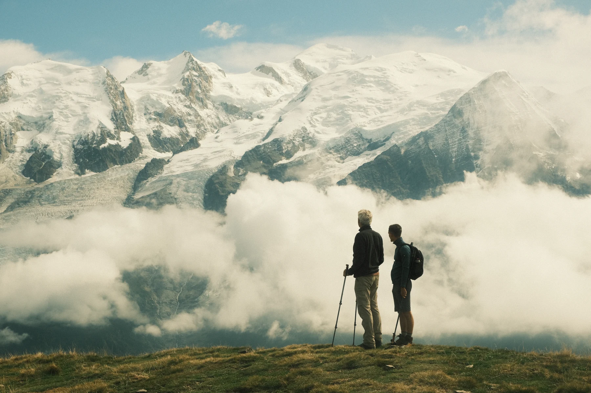</button>
          <figcaption class="plate__caption"><span class="plate__place">Chamonix, September 2025</span><span class="plate__settings"><span>34 mm</span><span>f/9</span><span>1/1250 s</span><span>ISO 640</span></span></figcaption>
        </figure>
      </div>
      <div class="plate" style="--r:0.6667">
        <figure class="plate__figure" style="--r:0.6667" data-full="images/arluxis/landscape_photography/DSCF2716.JPG" data-exif="X-T30 II|XF27mm F2.8|f/11|1/100 s|ISO 250">
          <button class="plate__open" type="button"></button>
          <figcaption class="plate__caption"><span class="plate__place">Chamonix, September 2025</span><span class="plate__settings"><span>27 mm</span><span>f/11</span><span>1/100 s</span><span>ISO 250</span></span></figcaption>
        </figure>
      </div>
      <div class="plate" style="--r:1.5">
        <figure class="plate__figure" style="--r:1.5" data-full="images/arluxis/landscape_photography/DSCF4227.JPG" data-exif="X-T30 II|XF18-55mm F2.8-4|39 mm|f/3.6|1/550 s|ISO 640|Classic Negative">
          <button class="plate__open" type="button"></button>
          <figcaption class="plate__caption"><span class="plate__place">Toronto, November 2025</span><span class="plate__settings"><span>39 mm</span><span>f/3.6</span><span>1/550 s</span><span>ISO 640</span></span></figcaption>
        </figure>
      </div>
      <div class="plate" style="--r:1.5">
        <figure class="plate__figure" style="--r:1.5" data-full="images/arluxis/landscape_photography/DSCF4560.jpg" data-exif="X-T30 II|XF18-55mm F2.8-4|46 mm|f/9|1/170 s|ISO 640">
          <button class="plate__open" type="button">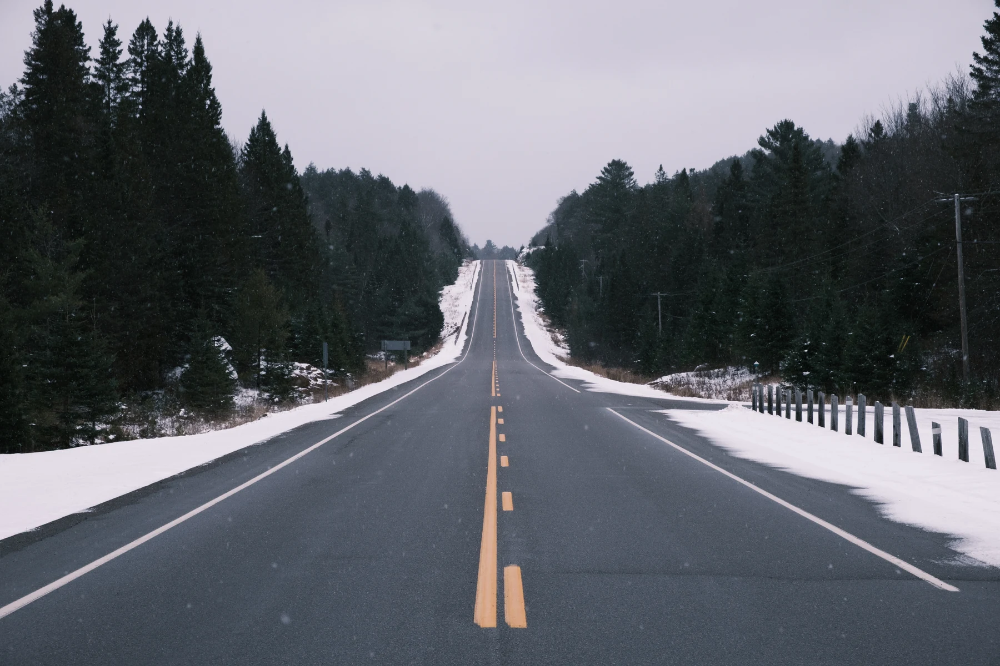</button>
          <figcaption class="plate__caption"><span class="plate__place">Toronto, November 2025</span><span class="plate__settings"><span>46 mm</span><span>f/9</span><span>1/170 s</span><span>ISO 640</span></span></figcaption>
        </figure>
      </div>
      <div class="plate" style="--r:1.5">
        <figure class="plate__figure" style="--r:1.5" data-full="images/arluxis/landscape_photography/DSCF5781-2.jpg" data-exif="X-T30 II|XF27mm F2.8|f/6.4|1/5000 s|ISO 640">
          <button class="plate__open" type="button">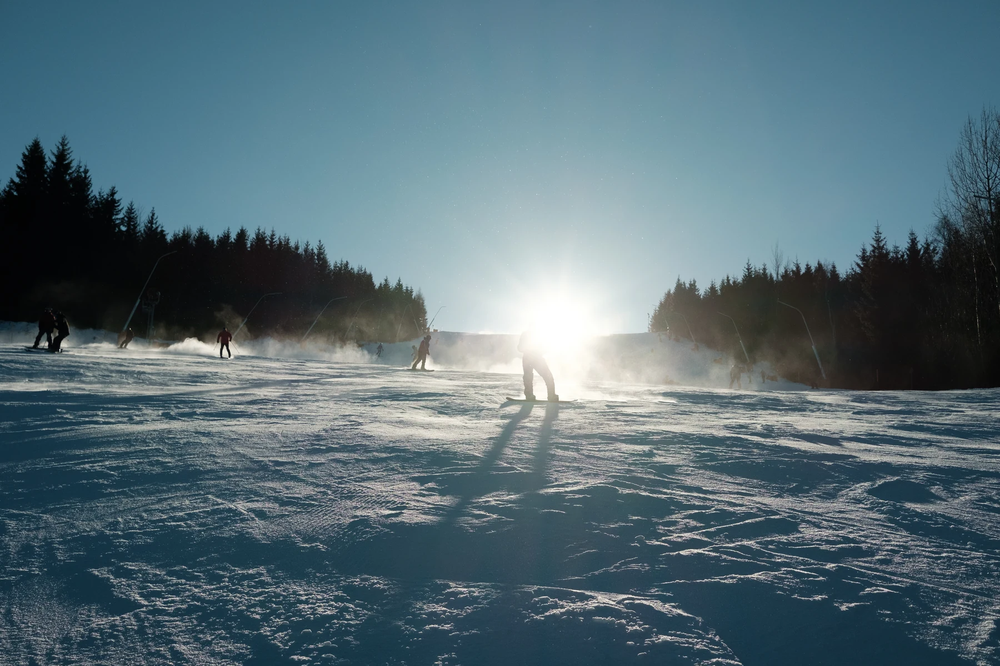</button>
          <figcaption class="plate__caption"><span class="plate__place">Harrachov, January 2026</span><span class="plate__settings"><span>27 mm</span><span>f/6.4</span><span>1/5000 s</span><span>ISO 640</span></span></figcaption>
        </figure>
      </div>
      <div class="plate" style="--r:1.5">
        <figure class="plate__figure" style="--r:1.5" data-full="images/arluxis/landscape_photography/DSCF5883-2.jpg" data-exif="X-T30 II|XF27mm F2.8|f/5.6|1/1250 s|ISO 640">
          <button class="plate__open" type="button"></button>
          <figcaption class="plate__caption"><span class="plate__place">Harrachov, January 2026</span><span class="plate__settings"><span>27 mm</span><span>f/5.6</span><span>1/1250 s</span><span>ISO 640</span></span></figcaption>
        </figure>
      </div>
    <p class="chapter__end"><a href="#sports" data-gallery="sports">Next gallery: Sports</a><a href="#top">Back to top</a></p>
  </section>

  <!-- Sports -->
  <section class="chapter" id="sports" data-gallery="sports" aria-labelledby="sports-title">
    <header class="chapter__head">
      <h2 class="chapter__title" tabindex="-1" id="sports-title">Sports</h2>
      <p class="chapter__places">The Cave Triathlon, Antwerp Marathon, Kings vs Maple Leafs, Volta a Catalunya, Ghent Marathon</p>
    </header>
      <div class="plate" style="--r:1.5">
        <figure class="plate__figure" style="--r:1.5" data-full="images/arluxis/sports_photography/DSCF1152.JPG" data-exif="X-T30 II|XF18-55mm F2.8-4|50 mm|f/7.1|1/4000 s|ISO 3200">
          <button class="plate__open" type="button"></button>
          <figcaption class="plate__caption"><span class="plate__place">The Cave Triathlon, July 2025</span><span class="plate__settings"><span>50 mm</span><span>f/7.1</span><span>1/4000 s</span><span>ISO 3200</span></span></figcaption>
        </figure>
      </div>
      <div class="plate" style="--r:1.5">
        <figure class="plate__figure" style="--r:1.5" data-full="images/arluxis/sports_photography/DSCF1158.JPG" data-exif="X-T30 II|XF18-55mm F2.8-4|48 mm|f/4.5|1/4000 s|ISO 800|Velvia">
          <button class="plate__open" type="button">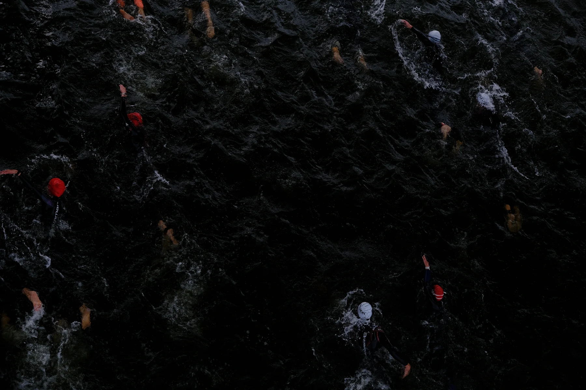</button>
          <figcaption class="plate__caption"><span class="plate__place">The Cave Triathlon, July 2025</span><span class="plate__settings"><span>48 mm</span><span>f/4.5</span><span>1/4000 s</span><span>ISO 800</span></span></figcaption>
        </figure>
      </div>
      <div class="plate" style="--r:1.5">
        <figure class="plate__figure" style="--r:1.5" data-full="images/arluxis/sports_photography/DSCF1175.JPG" data-exif="X-T30 II|XF18-55mm F2.8-4|55 mm|f/8|1/500 s|ISO 500">
          <button class="plate__open" type="button"></button>
          <figcaption class="plate__caption"><span class="plate__place">The Cave Triathlon, July 2025</span><span class="plate__settings"><span>55 mm</span><span>f/8</span><span>1/500 s</span><span>ISO 500</span></span></figcaption>
        </figure>
      </div>
      <div class="plate" style="--r:0.5628">
        <figure class="plate__figure" style="--r:0.5628" data-full="images/arluxis/sports_photography/DSCF3431-2.jpg" data-exif="X-T30 II|XF18-55mm F2.8-4|55 mm|f/6.4|1/280 s|ISO 320">
          <button class="plate__open" type="button">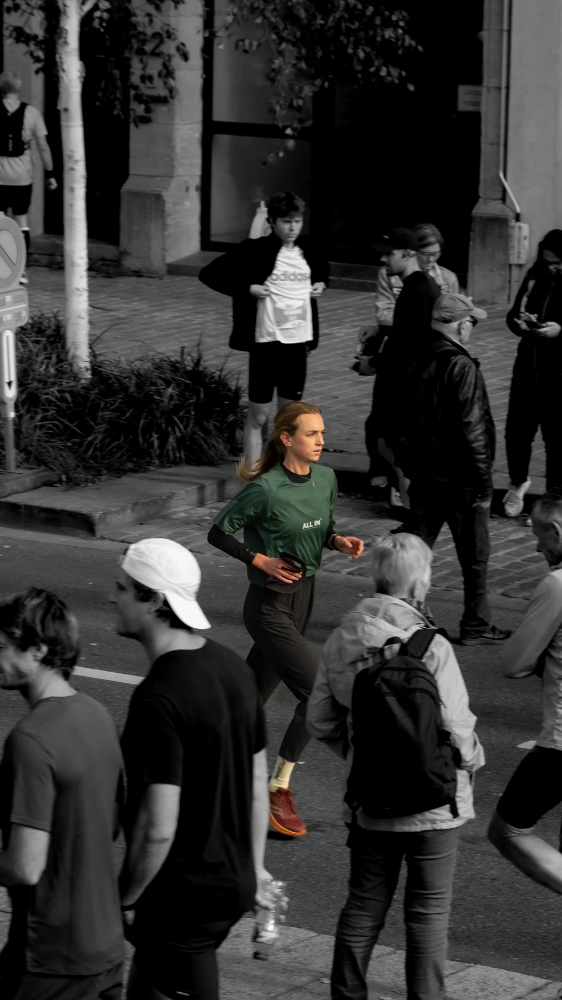</button>
          <figcaption class="plate__caption"><span class="plate__place">Antwerp Marathon, October 2025</span><span class="plate__settings"><span>55 mm</span><span>f/6.4</span><span>1/280 s</span><span>ISO 320</span></span></figcaption>
        </figure>
      </div>
      <div class="plate" style="--r:1.5">
        <figure class="plate__figure" style="--r:1.5" data-full="images/arluxis/sports_photography/DSCF3586.jpg" data-exif="X-T30 II|XF18-55mm F2.8-4|41 mm|f/5.6|1/900 s|ISO 320">
          <button class="plate__open" type="button"></button>
          <figcaption class="plate__caption"><span class="plate__place">Antwerp Marathon, October 2025</span><span class="plate__settings"><span>41 mm</span><span>f/5.6</span><span>1/900 s</span><span>ISO 320</span></span></figcaption>
        </figure>
      </div>
      <div class="plate" style="--r:1.3333">
        <figure class="plate__figure" style="--r:1.3333" data-full="images/arluxis/sports_photography/DSCF4309-2.jpg" data-exif="X-T30 II|XF18-55mm F2.8-4|55 mm|f/4|1/160 s|ISO 250">
          <button class="plate__open" type="button"></button>
          <figcaption class="plate__caption"><span class="plate__place">Kings vs Maple Leafs, November 2025</span><span class="plate__settings"><span>55 mm</span><span>f/4</span><span>1/160 s</span><span>ISO 250</span></span></figcaption>
        </figure>
      </div>
      <div class="plate" style="--r:1.4196">
        <figure class="plate__figure" style="--r:1.4196" data-full="images/arluxis/sports_photography/DSCF4289-2.jpg" data-exif="X-T30 II|XF18-55mm F2.8-4|55 mm|f/4|1/400 s|ISO 640">
          <button class="plate__open" type="button"></button>
          <figcaption class="plate__caption"><span class="plate__place">Kings vs Maple Leafs, November 2025</span><span class="plate__settings"><span>55 mm</span><span>f/4</span><span>1/400 s</span><span>ISO 640</span></span></figcaption>
        </figure>
      </div>
      <div class="plate" style="--r:1.3333">
        <figure class="plate__figure" style="--r:1.3333" data-full="images/arluxis/sports_photography/DSCF4312-2.jpg" data-exif="X-T30 II|XF18-55mm F2.8-4|55 mm|f/4|1/160 s|ISO 250">
          <button class="plate__open" type="button"></button>
          <figcaption class="plate__caption"><span class="plate__place">Kings vs Maple Leafs, November 2025</span><span class="plate__settings"><span>55 mm</span><span>f/4</span><span>1/160 s</span><span>ISO 250</span></span></figcaption>
        </figure>
      </div>
      <div class="plate plate--spread" style="--r:1.3334">
        <div class="plate__pair">
          <figure class="plate__figure" style="--r:0.6667" data-full="images/arluxis/sports_photography/DSCF7835.JPG" data-exif="X-T30 II|XF18-55mm F2.8-4|55 mm|f/7.1|1/4000 s|ISO 2000|Classic Chrome">
            <button class="plate__open" type="button">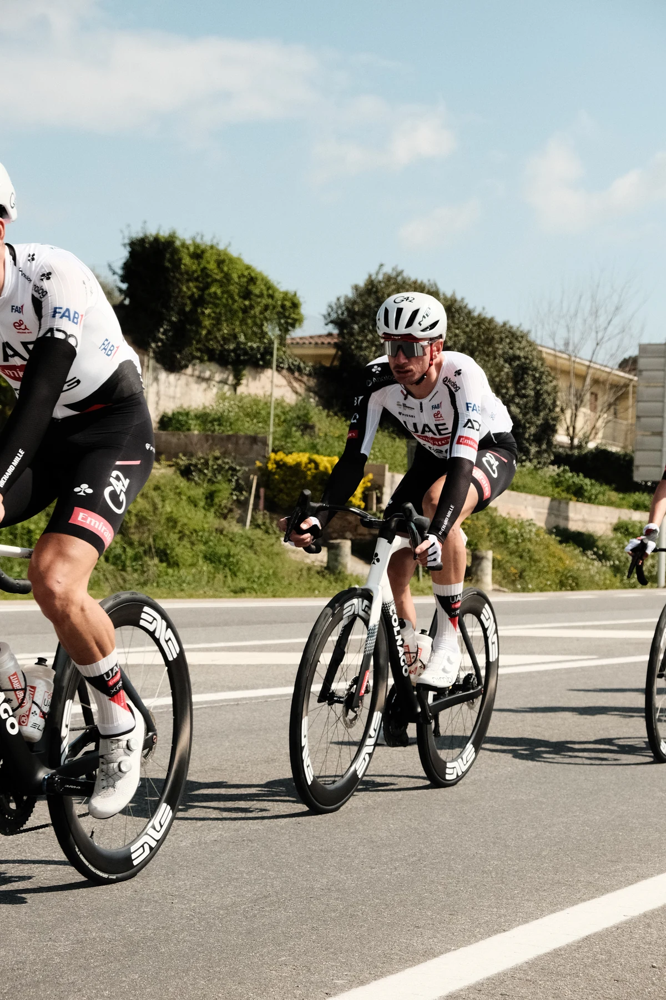</button>
            <figcaption class="plate__caption"><span class="plate__place">Volta a Catalunya, March 2026</span><span class="plate__settings"><span>55 mm</span><span>f/7.1</span><span>1/4000 s</span><span>ISO 2000</span></span></figcaption>
          </figure>
          <figure class="plate__figure" style="--r:0.6667" data-full="images/arluxis/sports_photography/DSCF7973.JPG" data-exif="X-T30 II|XF18-55mm F2.8-4|55 mm|f/8|1/210 s|ISO 320|Classic Chrome">
            <button class="plate__open" type="button">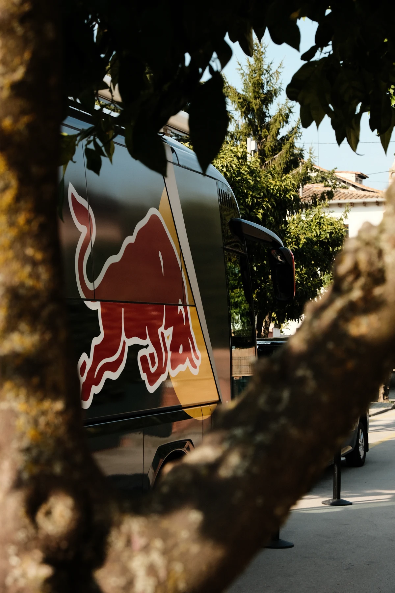</button>
            <figcaption class="plate__caption"><span class="plate__place">Volta a Catalunya, March 2026</span><span class="plate__settings"><span>55 mm</span><span>f/8</span><span>1/210 s</span><span>ISO 320</span></span></figcaption>
          </figure>
        </div>
      </div>
      <div class="plate" style="--r:0.6667">
        <figure class="plate__figure" style="--r:0.6667" data-full="images/arluxis/sports_photography/DSCF8051.JPG" data-exif="X-T30 II|XF18-55mm F2.8-4|32 mm|f/20|1/30 s|ISO 320|Classic Chrome">
          <button class="plate__open" type="button"></button>
          <figcaption class="plate__caption"><span class="plate__place">Volta a Catalunya, March 2026</span><span class="plate__settings"><span>32 mm</span><span>f/20</span><span>1/30 s</span><span>ISO 320</span></span></figcaption>
        </figure>
      </div>
      <div class="plate plate--spread" style="--r:1.3334">
        <div class="plate__pair">
          <figure class="plate__figure" style="--r:0.6667" data-full="images/arluxis/sports_photography/DSCF8837.JPG" data-exif="X-T30 II|XF18-55mm F2.8-4|53 mm|f/4|1/60 s|ISO 3200|Classic Chrome">
            <button class="plate__open" type="button"></button>
            <figcaption class="plate__caption"><span class="plate__place">Ghent Marathon, March 2026</span><span class="plate__settings"><span>53 mm</span><span>f/4</span><span>1/60 s</span><span>ISO 3200</span></span></figcaption>
          </figure>
          <figure class="plate__figure" style="--r:0.6667" data-full="images/arluxis/sports_photography/DSCF8840.JPG" data-exif="X-T30 II|XF18-55mm F2.8-4|55 mm|f/4|1/60 s|ISO 3200|Classic Chrome">
            <button class="plate__open" type="button"></button>
            <figcaption class="plate__caption"><span class="plate__place">Ghent Marathon, March 2026</span><span class="plate__settings"><span>55 mm</span><span>f/4</span><span>1/60 s</span><span>ISO 3200</span></span></figcaption>
          </figure>
        </div>
      </div>
      <div class="plate" style="--r:1.5">
        <figure class="plate__figure" style="--r:1.5" data-full="images/arluxis/sports_photography/DSCF8854.JPG" data-exif="X-T30 II|XF18-55mm F2.8-4|48 mm|f/4|1/60 s|ISO 3200|Classic Chrome">
          <button class="plate__open" type="button">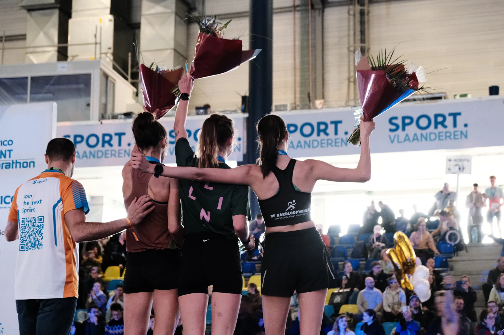</button>
          <figcaption class="plate__caption"><span class="plate__place">Ghent Marathon, March 2026</span><span class="plate__settings"><span>48 mm</span><span>f/4</span><span>1/60 s</span><span>ISO 3200</span></span></figcaption>
        </figure>
      </div>
    <p class="chapter__end"><a href="#street" data-gallery="street">Next gallery: Street</a><a href="#top">Back to top</a></p>
  </section>

  <!-- Street -->
  <section class="chapter" id="street" data-gallery="street" aria-labelledby="street-title">
    <header class="chapter__head">
      <h2 class="chapter__title" tabindex="-1" id="street-title">Street</h2>
      <p class="chapter__places">Stockholm, Ghent, Toronto, Girona, Rotterdam</p>
    </header>
      <div class="plate plate--spread" style="--r:1.3334">
        <div class="plate__pair">
          <figure class="plate__figure" style="--r:0.6667" data-full="images/arluxis/street_photography/DSCF1058.jpg" data-exif="X-T30 II|XF18-55mm F2.8-4|42 mm|f/7.1|1/125 s|ISO 1250">
            <button class="plate__open" type="button">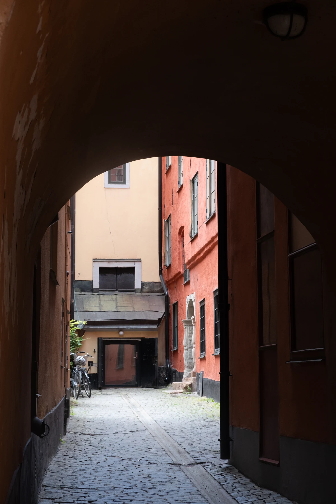</button>
            <figcaption class="plate__caption"><span class="plate__place">Stockholm, July 2025</span><span class="plate__settings"><span>42 mm</span><span>f/7.1</span><span>1/125 s</span><span>ISO 1250</span></span></figcaption>
          </figure>
          <figure class="plate__figure" style="--r:0.6667" data-full="images/arluxis/street_photography/DSCF1106.jpg" data-exif="X-T30 II|XF18-55mm F2.8-4|50 mm|f/7.1|1/170 s|ISO 160">
            <button class="plate__open" type="button">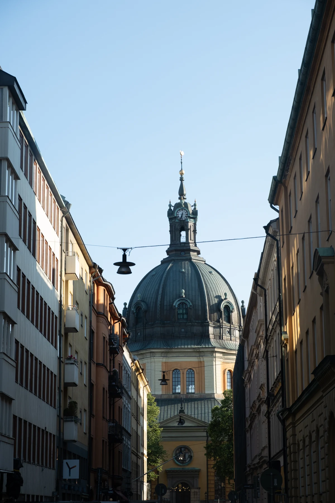</button>
            <figcaption class="plate__caption"><span class="plate__place">Stockholm, July 2025</span><span class="plate__settings"><span>50 mm</span><span>f/7.1</span><span>1/170 s</span><span>ISO 160</span></span></figcaption>
          </figure>
        </div>
      </div>
      <div class="plate plate--spread" style="--r:1.3334">
        <div class="plate__pair">
          <figure class="plate__figure" style="--r:0.6667" data-full="images/arluxis/street_photography/DSCF1634.JPG" data-exif="X-T30 II|XF18-55mm F2.8-4|37 mm|f/4.5|1/56 s|ISO 640|Classic Chrome">
            <button class="plate__open" type="button">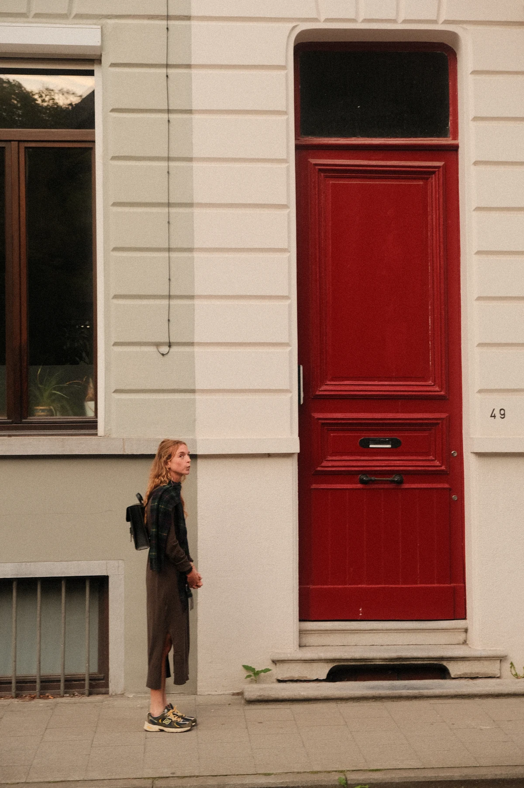</button>
            <figcaption class="plate__caption"><span class="plate__place">Ghent, August 2025</span><span class="plate__settings"><span>37 mm</span><span>f/4.5</span><span>1/56 s</span><span>ISO 640</span></span></figcaption>
          </figure>
          <figure class="plate__figure" style="--r:0.6667" data-full="images/arluxis/street_photography/DSCF1775.JPG" data-exif="X-T30 II|XF18-55mm F2.8-4|37 mm|f/7.1|1/110 s|ISO 640">
            <button class="plate__open" type="button">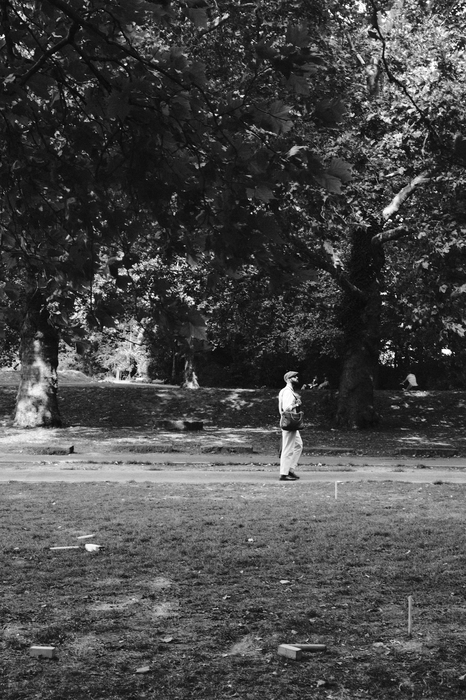</button>
            <figcaption class="plate__caption"><span class="plate__place">Ghent, August 2025</span><span class="plate__settings"><span>37 mm</span><span>f/7.1</span><span>1/110 s</span><span>ISO 640</span></span></figcaption>
          </figure>
        </div>
      </div>
      <div class="plate" style="--r:0.6667">
        <figure class="plate__figure" style="--r:0.6667" data-full="images/arluxis/street_photography/DSCF2414.JPG" data-exif="X-T30 II|XF18-55mm F2.8-4|55 mm|f/5.6|1/1000 s|ISO 640|Classic Negative">
          <button class="plate__open" type="button"></button>
          <figcaption class="plate__caption"><span class="plate__place">Ghent, September 2025</span><span class="plate__settings"><span>55 mm</span><span>f/5.6</span><span>1/1000 s</span><span>ISO 640</span></span></figcaption>
        </figure>
      </div>
      <div class="plate" style="--r:0.75">
        <figure class="plate__figure" style="--r:0.75" data-full="images/arluxis/street_photography/DSCF3907.jpg" data-exif="X-T30 II|XF27mm F2.8|f/3.6|1/100 s|ISO 320">
          <button class="plate__open" type="button"></button>
          <figcaption class="plate__caption"><span class="plate__place">Toronto, November 2025</span><span class="plate__settings"><span>27 mm</span><span>f/3.6</span><span>1/100 s</span><span>ISO 320</span></span></figcaption>
        </figure>
      </div>
      <div class="plate" style="--r:1.3333">
        <figure class="plate__figure" style="--r:1.3333" data-full="images/arluxis/street_photography/DSCF3916.jpg" data-exif="X-T30 II|XF27mm F2.8|f/2.8|1/100 s|ISO 160">
          <button class="plate__open" type="button">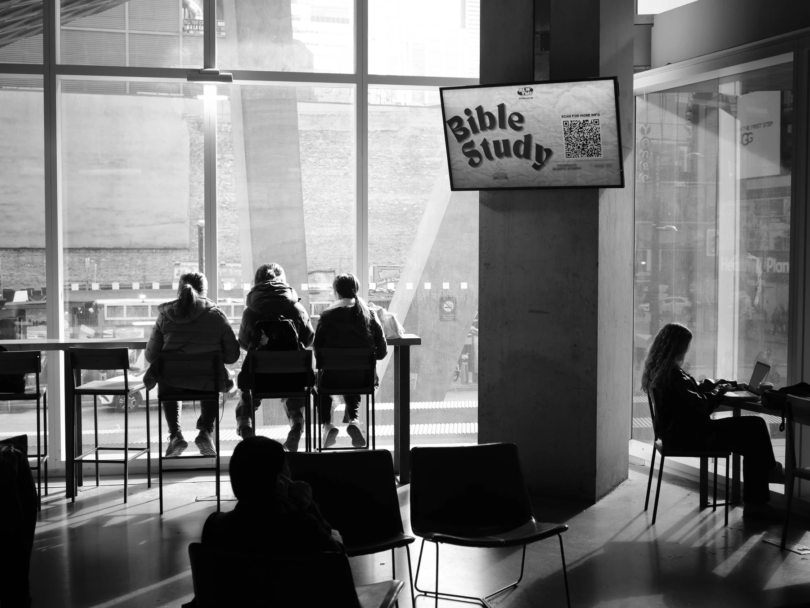</button>
          <figcaption class="plate__caption"><span class="plate__place">Toronto, November 2025</span><span class="plate__settings"><span>27 mm</span><span>f/2.8</span><span>1/100 s</span><span>ISO 160</span></span></figcaption>
        </figure>
      </div>
      <div class="plate plate--spread" style="--r:1.5">
        <div class="plate__pair">
          <figure class="plate__figure" style="--r:0.75" data-full="images/arluxis/street_photography/DSCF3931.jpg" data-exif="X-T30 II|XF27mm F2.8|f/4.5|1/125 s|ISO 160">
            <button class="plate__open" type="button">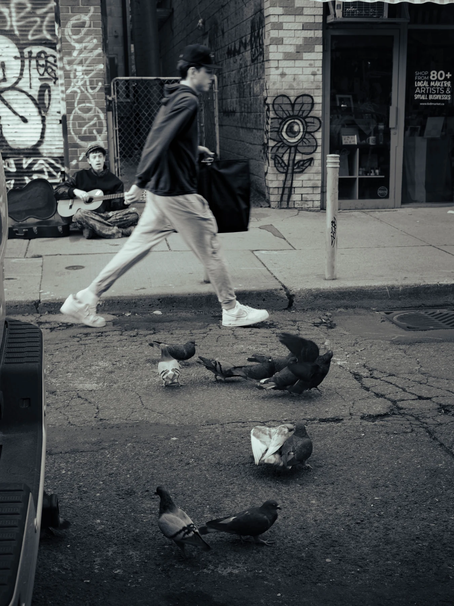</button>
            <figcaption class="plate__caption"><span class="plate__place">Toronto, November 2025</span><span class="plate__settings"><span>27 mm</span><span>f/4.5</span><span>1/125 s</span><span>ISO 160</span></span></figcaption>
          </figure>
          <figure class="plate__figure" style="--r:0.75" data-full="images/arluxis/street_photography/DSCF3933.jpg" data-exif="X-T30 II|XF27mm F2.8|f/4.5|1/280 s|ISO 320">
            <button class="plate__open" type="button">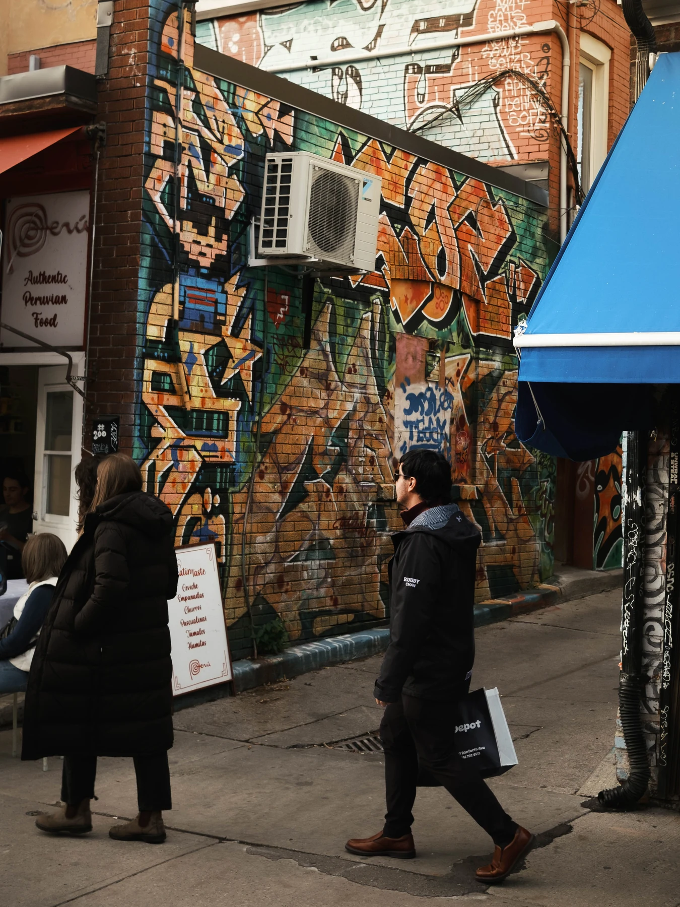</button>
            <figcaption class="plate__caption"><span class="plate__place">Toronto, November 2025</span><span class="plate__settings"><span>27 mm</span><span>f/4.5</span><span>1/280 s</span><span>ISO 320</span></span></figcaption>
          </figure>
        </div>
      </div>
      <div class="plate plate--spread" style="--r:1.3334">
        <div class="plate__pair">
          <figure class="plate__figure" style="--r:0.6667" data-full="images/arluxis/street_photography/DSCF4003.JPG" data-exif="X-T30 II|XF27mm F2.8|f/2.8|1/250 s|ISO 640|Classic Negative">
            <button class="plate__open" type="button"></button>
            <figcaption class="plate__caption"><span class="plate__place">Toronto, November 2025</span><span class="plate__settings"><span>27 mm</span><span>f/2.8</span><span>1/250 s</span><span>ISO 640</span></span></figcaption>
          </figure>
          <figure class="plate__figure" style="--r:0.6667" data-full="images/arluxis/street_photography/DSCF4010.JPG" data-exif="X-T30 II|XF27mm F2.8|f/2.8|1/1300 s|ISO 640|Classic Negative">
            <button class="plate__open" type="button"></button>
            <figcaption class="plate__caption"><span class="plate__place">Toronto, November 2025</span><span class="plate__settings"><span>27 mm</span><span>f/2.8</span><span>1/1300 s</span><span>ISO 640</span></span></figcaption>
          </figure>
        </div>
      </div>
      <div class="plate" style="--r:0.6667">
        <figure class="plate__figure" style="--r:0.6667" data-full="images/arluxis/street_photography/DSCF7713.JPG" data-exif="X-T30 II|XF18-55mm F2.8-4|32 mm|f/8|1/1000 s|ISO 320|Classic Negative">
          <button class="plate__open" type="button"></button>
          <figcaption class="plate__caption"><span class="plate__place">Girona, March 2026</span><span class="plate__settings"><span>32 mm</span><span>f/8</span><span>1/1000 s</span><span>ISO 320</span></span></figcaption>
        </figure>
      </div>
      <div class="plate" style="--r:1.5">
        <figure class="plate__figure" style="--r:1.5" data-full="images/arluxis/street_photography/DSCF7925.JPG" data-exif="X-T30 II|XF18-55mm F2.8-4|37 mm|f/8|1/1000 s|ISO 1250|Classic Chrome">
          <button class="plate__open" type="button">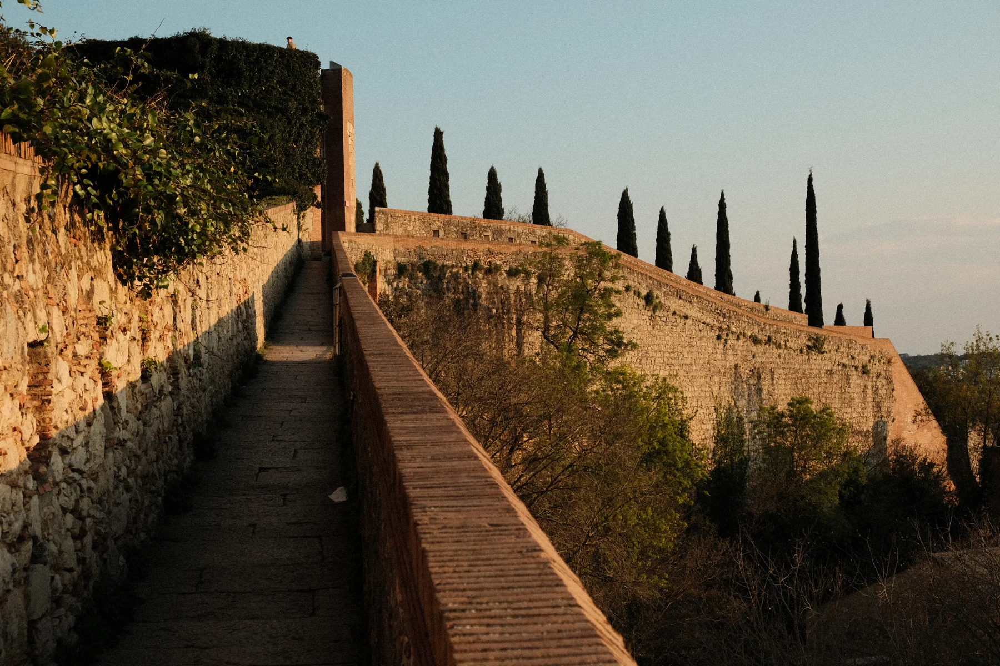</button>
          <figcaption class="plate__caption"><span class="plate__place">Girona, March 2026</span><span class="plate__settings"><span>37 mm</span><span>f/8</span><span>1/1000 s</span><span>ISO 1250</span></span></figcaption>
        </figure>
      </div>
      <div class="plate" style="--r:1.5">
        <figure class="plate__figure" style="--r:1.5" data-full="images/arluxis/street_photography/DSCF7927.JPG" data-exif="X-T30 II|XF18-55mm F2.8-4|18 mm|f/8|1/1000 s|ISO 1000|Classic Chrome">
          <button class="plate__open" type="button"></button>
          <figcaption class="plate__caption"><span class="plate__place">Girona, March 2026</span><span class="plate__settings"><span>18 mm</span><span>f/8</span><span>1/1000 s</span><span>ISO 1000</span></span></figcaption>
        </figure>
      </div>
      <div class="plate" style="--r:1.5">
        <figure class="plate__figure" style="--r:1.5" data-full="images/arluxis/street_photography/DSCF8216.JPG" data-exif="X-T30 II|XF27mm F2.8|f/4|1/2500 s|ISO 640|Classic Chrome">
          <button class="plate__open" type="button"></button>
          <figcaption class="plate__caption"><span class="plate__place">Girona, March 2026</span><span class="plate__settings"><span>27 mm</span><span>f/4</span><span>1/2500 s</span><span>ISO 640</span></span></figcaption>
        </figure>
      </div>
      <div class="plate plate--spread" style="--r:1.3334">
        <div class="plate__pair">
          <figure class="plate__figure" style="--r:0.6667" data-full="images/arluxis/street_photography/DSCF9156.JPG" data-exif="X-T30 II|XF27mm F2.8|f/7.1|1/2000 s|ISO 640|Classic Negative">
            <button class="plate__open" type="button"></button>
            <figcaption class="plate__caption"><span class="plate__place">Rotterdam, April 2026</span><span class="plate__settings"><span>27 mm</span><span>f/7.1</span><span>1/2000 s</span><span>ISO 640</span></span></figcaption>
          </figure>
          <figure class="plate__figure" style="--r:0.6667" data-full="images/arluxis/street_photography/DSCF9170.JPG" data-exif="X-T30 II|XF27mm F2.8|f/7.1|1/2000 s|ISO 800|Classic Negative">
            <button class="plate__open" type="button"></button>
            <figcaption class="plate__caption"><span class="plate__place">Rotterdam, April 2026</span><span class="plate__settings"><span>27 mm</span><span>f/7.1</span><span>1/2000 s</span><span>ISO 800</span></span></figcaption>
          </figure>
        </div>
      </div>
    <p class="chapter__end"><a href="#landscape" data-gallery="landscape">Next gallery: Landscape</a><a href="#top">Back to top</a></p>
  </section>

</div>

<footer class="colophon">
  <p>Landscape, sport and street photography by Arthur Declercq, made with Fujifilm cameras.</p>
  <p class="colophon__small">&copy; 2026 Arthur Declercq. <a href="https://www.instagram.com/arluxis/" target="_blank" rel="noopener">More photographs on Instagram</a></p>
</footer>

<!-- Viewer for full-size photos -->
<div class="viewer" id="viewer" role="dialog" aria-modal="true" aria-label="Photo viewer" hidden>
  <div class="viewer__bar">
    <p class="viewer__count" aria-live="polite"></p>
    <button class="viewer__close" type="button">Close</button>
  </div>
  <div class="viewer__stage">
    
  </div>
  <div class="viewer__info">
    <p class="viewer__title"></p>
    <p class="viewer__exif"></p>
  </div>
  <button class="viewer__nav viewer__nav--prev" type="button" aria-label="Previous photo">
    <svg viewBox="0 0 22 40" aria-hidden="true"><path d="M20 2 3 20l17 18" fill="none" stroke="currentColor" stroke-width="1.5"/></svg>
  </button>
  <button class="viewer__nav viewer__nav--next" type="button" aria-label="Next photo">
    <svg viewBox="0 0 22 40" aria-hidden="true"><path d="m2 2 17 18L2 38" fill="none" stroke="currentColor" stroke-width="1.5"/></svg>
  </button>
</div>

<script>
  (function () {
    var root = document.documentElement;
    root.classList.add('js');

    // Fade each photo in once it has loaded
    document.querySelectorAll('figure[data-full] img').forEach(function (img) {
      if (img.complete) {
        img.classList.add('is-loaded');
        return;
      }
      var done = function () { img.classList.add('is-loaded'); };
      img.addEventListener('load', done, { once: true });
      img.addEventListener('error', done, { once: true });
    });

    // The viewer moves through the photos of one gallery at a time
    var figures = [];
    var viewer = document.getElementById('viewer');
    var img = viewer.querySelector('.viewer__img');
    var title = viewer.querySelector('.viewer__title');
    var exif = viewer.querySelector('.viewer__exif');
    var count = viewer.querySelector('.viewer__count');
    var closeBtn = viewer.querySelector('.viewer__close');
    var prevBtn = viewer.querySelector('.viewer__nav--prev');
    var nextBtn = viewer.querySelector('.viewer__nav--next');
    var focusable = [closeBtn, prevBtn, nextBtn];
    var current = 0;
    var opener = null;

    // Only fetch the full-size JPG on screens that can show more than the 1800 px preview
    var wantsFull = Math.max(screen.width, screen.height) * (window.devicePixelRatio || 1) > 2000;

    function wrap(i) {
      return (i + figures.length) % figures.length;
    }

    function show(i) {
      current = wrap(i);
      var fig = figures[current];
      var thumb = fig.querySelector('img');

      // Restart the short fade for each new photo
      img.style.animation = 'none';
      void img.offsetWidth;
      img.style.animation = '';

      img.src = thumb.currentSrc || thumb.src;
      img.alt = thumb.alt;
      title.textContent = thumb.alt;
      count.textContent = (current + 1) + ' / ' + figures.length;

      exif.textContent = '';
      (fig.dataset.exif || '').split('|').forEach(function (item) {
        if (!item) return;
        var span = document.createElement('span');
        span.textContent = item;
        exif.appendChild(span);
      });

      if (wantsFull) {
        var shown = current;
        var full = new Image();
        full.onload = function () {
          if (shown === current && !viewer.hidden) img.src = full.src;
        };
        full.src = fig.dataset.full;
      }

      // Warm up the neighbouring previews
      [current - 1, current + 1].forEach(function (j) {
        new Image().src = figures[wrap(j)].querySelector('img').src;
      });
    }

    function open(i, from) {
      opener = from;
      viewer.hidden = false;
      root.classList.add('viewer-open');
      show(i);
      closeBtn.focus();
    }

    function close() {
      viewer.hidden = true;
      root.classList.remove('viewer-open');
      img.removeAttribute('src');
      if (opener) opener.focus();
    }

    document.querySelectorAll('figure[data-full]').forEach(function (fig) {
      fig.querySelector('button').addEventListener('click', function () {
        var gallery = fig.closest('.chapter') || document;
        figures = Array.prototype.slice.call(gallery.querySelectorAll('figure[data-full]'));
        open(figures.indexOf(fig), this);
      });
    });

    closeBtn.addEventListener('click', close);
    prevBtn.addEventListener('click', function () { show(current - 1); });
    nextBtn.addEventListener('click', function () { show(current + 1); });

    // Clicking the empty space around the photo closes the viewer
    viewer.addEventListener('click', function (e) {
      if (e.target === viewer || e.target.classList.contains('viewer__stage')) close();
    });

    document.addEventListener('keydown', function (e) {
      if (viewer.hidden) return;
      if (e.key === 'Escape') {
        close();
      } else if (e.key === 'ArrowLeft') {
        show(current - 1);
      } else if (e.key === 'ArrowRight') {
        show(current + 1);
      } else if (e.key === 'Tab') {
        // Keep keyboard focus inside the viewer
        var k = focusable.indexOf(document.activeElement);
        focusable[(k + (e.shiftKey ? -1 : 1) + focusable.length) % focusable.length].focus();
        e.preventDefault();
      }
    });

    // Swipe left or right on touch screens
    var startX = null;
    viewer.addEventListener('touchstart', function (e) {
      startX = e.touches[0].clientX;
    }, { passive: true });
    viewer.addEventListener('touchend', function (e) {
      if (startX === null) return;
      var dx = e.changedTouches[0].clientX - startX;
      startX = null;
      if (Math.abs(dx) > 50) show(current + (dx < 0 ? 1 : -1));
    });

    // Show one gallery at a time. Sports opens first; a link such as
    // arluxis.html#street opens that gallery instead.
    var chapters = document.querySelectorAll('.chapter');
    var tabs = document.querySelectorAll('.galleries__link');

    function isGallery(key) {
      return !!document.querySelector('.chapter[data-gallery="' + key + '"]');
    }

    function select(key) {
      chapters.forEach(function (c) { c.hidden = c.dataset.gallery !== key; });
      tabs.forEach(function (t) {
        if (t.dataset.gallery === key) t.setAttribute('aria-current', 'true');
        else t.removeAttribute('aria-current');
      });
    }

    var start = location.hash.slice(1);
    select(isGallery(start) ? start : 'sports');

    document.querySelectorAll('a[data-gallery]').forEach(function (a) {
      a.addEventListener('click', function (e) {
        e.preventDefault();
        var key = a.dataset.gallery;
        select(key);
        history.replaceState(null, '', '#' + key);
        // Bring the start of the gallery up to just below the tab bar
        var chapter = document.getElementById(key);
        chapter.scrollIntoView();
        chapter.querySelector('.chapter__title').focus({ preventScroll: true });
      });
    });

    window.addEventListener('hashchange', function () {
      var key = location.hash.slice(1);
      if (isGallery(key)) select(key);
    });

    // Draw a thin line under the tab bar once it sticks to the top
    var bar = document.getElementById('galleries');
    if ('IntersectionObserver' in window) {
      new IntersectionObserver(function (entries) {
        bar.classList.toggle('is-stuck', entries[0].intersectionRatio < 1);
      }, { rootMargin: '-1px 0px 0px 0px', threshold: 1 }).observe(bar);
    }

  })();
</script>
```
